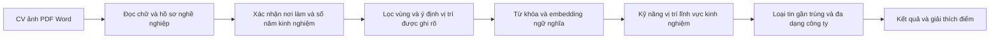

# Thuật toán gợi ý kết hợp phiên bản 2

## Phạm vi

JobVista dùng `HybridJobRecommenderSystem` trên catalog 500 tin. Phiên bản cũ
`JobRecommenderSystem` vẫn giữ nguyên cách xếp hạng làm baseline A/B.
Notebook có ví dụ và bảng đánh giá; JobVista là giao diện web duy nhất. Không dùng dịch vụ
LLM/OCR trả phí, không lưu CV người dùng vào index hay tập huấn luyện.



## 1 Kết hợp từ khóa với ngữ nghĩa

TF-IDF và embedding đa ngôn ngữ biểu diễn cùng tin tuyển dụng; cosine được tính
cho từng truy vấn rồi kết hợp với các đặc trưng nghề nghiệp. Sentence Transformers
dùng `paraphrase-multilingual-MiniLM-L12-v2`, revision
`e8f8c211226b894fcb81acc59f3b34ba3efd5f42`, chạy CPU tối đa 4 luồng Torch.
Văn bản dài chia theo số token và gộp trung bình các đoạn, chuẩn hóa L2; không
cắt im lặng phần cuối CV. Cosine semantic âm được chặn về 0 cho điểm kết hợp.

`PublicSemanticIndex` chỉ cache ma trận vector tin công khai, theo SHA256 của
model, revision, schema và toàn bộ văn bản. Đổi tin làm đổi cache key. Không ghi
embedding, văn bản hoặc điểm truy vấn CV xuống cache. Mẫu ngữ nghĩa được chuẩn
bị ở nền khi mở FastAPI; truy vấn đầu có thể phải chờ nếu index chưa xong.

`localize_jobs` giữ `Original_*` để nội dung được so khớp và nhóm công ty không
đổi khi người dùng chuyển ngôn ngữ. Văn bản hiển thị vẫn dùng bản Việt/Anh.

Nếu model/thư viện không dùng được, các điểm ngữ nghĩa không được bịa ra:
API ghi rõ `hybrid-lexical`, giao diện thông báo, trọng số semantic bằng 0.
Khởi động lại sau khi cài dependency hoặc khắc phục model để thử lại.

## 2 Kinh nghiệm có cấu trúc

Đầu vào tin tuyển dụng được chuẩn hóa bởi `job_experience.py`: dùng trường
kinh nghiệm nguồn khi có số rõ; nếu thiếu thì đọc yêu cầu riêng, rồi phần yêu
cầu trong JD gộp. Chuỗi `Không` không tự được hiểu là 0 năm. Bằng chứng và
nguồn suy ra được giữ trong catalog; không lấy tuổi, năm học, phúc lợi hoặc
thâm niên công ty làm kinh nghiệm ứng viên cần có. Bản sửa 16/10/2026 phục hồi
67 tin thiếu số năm, giữ nguyên nội dung nguồn; đã chạy lại đánh giá trên dữ
liệu chuẩn hóa mới với cùng CV/nhãn và trọng số.

`extract_experience` nhận các câu nêu rõ số năm kinh nghiệm/thực hành và ưu tiên
tổng kinh nghiệm được ghi rõ. Không cộng các dự án có thể trùng thời gian,
không lấy tuổi/năm tốt nghiệp để suy ra kinh nghiệm. Nhiều con số mâu thuẫn
hoặc khoảng năm chưa rõ trả `ambiguous`; không có thông tin trả `unknown`.
Người dùng có thể xác nhận/sửa số năm hoặc để trống trên web mới.

Với số năm ứng viên `c` và mức tối thiểu trong tin `r`, điểm mềm:

`Experience = exp(-max(0, r-c)/2)`.

Đạt/vượt mức tối thiểu có điểm 1; thiếu năm giảm dần chứ không loại cứng.
Không suy đoán overqualified vì phần lớn tin chỉ cung cấp cận dưới. Nếu CV
hoặc tin không rõ số năm, thành phần này được bỏ khỏi công thức và chuẩn hóa
lại trọng số. `0 năm` được nêu rõ khác với `chưa xác định`.

## 3 Kỹ năng và vị trí có thể giải thích

Kỹ năng được chuẩn hóa qua từ điển alias có ranh giới từ (Java khác JavaScript,
C++ khác C#). Câu trong phần yêu cầu có dấu hiệu rõ như `must-have`, `bắt buộc`,
`mandatory` được gán bắt buộc. Câu có `ưu tiên`, `là lợi thế`, `preferred` hoặc
`nice-to-have` được gán ưu tiên. Không tự coi tất cả kỹ năng metadata là bắt buộc.
Nếu câu trộn nhiều loại điều kiện, cách trích xuất còn có thể sai và cần rà lại.

- Trọng số kỹ năng trong tin: bắt buộc 2, được nhắc 1, ưu tiên 0,5.
- `Job_Skill_Coverage`: tổng trọng số kỹ năng trùng / tổng trọng số kỹ năng tin.
- `CV_Skill_Coverage`: số kỹ năng trùng / số kỹ năng nhận diện từ CV.
- `Skills = (0.6*CV_Skill_Coverage + 0.4*Job_Skill_Coverage) * penalty`.
- `penalty = 1 - 0.5*(số kỹ năng bắt buộc chưa thấy / số kỹ năng bắt buộc)`;
  không có nhãn bắt buộc thì penalty bằng 1.

Các tỷ lệ này là tín hiệu xếp hạng, không phải xác nhận ứng viên đủ điều kiện.
Giao diện dùng từ **chưa thấy trong CV**, không kết luận ứng viên không có kỹ năng.

Điểm vị trí dùng nhóm nghề và bảng nghề gần nhau (ví dụ Data Analyst/BI,
Backend/Full Stack). Lĩnh vực được đối chiếu từ nhóm nghề. Khi CV ghi rõ vị trí
ứng tuyển, các nghề rõ ràng khác được loại khỏi danh sách, tránh lấp đủ top N
bằng tin không đúng nguyện vọng. Nếu vị trí ứng tuyển nêu ngôn ngữ cụ thể và
chức danh tin nêu ngôn ngữ khác, không đưa tin xung đột đó vào. Vai trò suy ra
từ nội dung chung không được coi là nguyện vọng cứng.

Trọng số khởi điểm cố định trước tập test:

| Thành phần | Trọng số |
|---|---:|
| Từ khóa | 0,15 |
| Ngữ nghĩa | 0,25 |
| Kỹ năng | 0,30 |
| Vị trí | 0,15 |
| Lĩnh vực | 0,05 |
| Kinh nghiệm | 0,10 |

`Score = sum(active_weight * component)`. Mỗi tin có thể có trọng số hiệu lực
khác nhau khi thiếu dữ liệu; tổng trọng số hiệu lực luôn bằng 1. API trả cả điểm
và trọng số để giao diện giải thích đúng, không hiển thị 0 điểm cho phần chưa rõ.
Ngưỡng cơ sở 0,12 và điều kiện có tín hiệu nghề nghiệp/kỹ năng/nội dung giúp tránh
trả kết quả hoàn toàn không liên quan. Các ngưỡng này vẫn cần dữ liệu thực để hiệu chỉnh.

## 4 Tin gần trùng và đa dạng công ty

Chỉ nhóm gần trùng khi cùng công ty gốc, cùng vùng, cùng cấp bậc, chức danh
gần nhau (SequenceMatcher >= 0,88) và phần đầu mô tả nguồn gần nhau (>= 0,88;
tối đa 2500 ký tự). Không nhóm chỉ vì cùng Role_Code, không trộn Junior với Senior.
Không xóa dòng nào khỏi catalog 500 tin; chỉ chọn một đại diện trong kết quả.

Ưu tiên tối đa 2 tin mỗi công ty nếu có tin từ công ty khác đạt ít nhất 85%
điểm của tin cần thay. Nếu không có lựa chọn đủ gần, giữ tin tốt hơn. Tin tương
tự loại cả nhóm gần trùng của tin đang xem. Mọi bước vẫn giữ điều kiện vùng,
không lấp top N bằng các bản sao hoặc tin ở địa điểm khác.

## 5 Đánh giá có thể tái lập

`data/evaluation/benchmark.json` đóng băng 30 CV giả lập (10 dev, 20 test),
qrels pilot biên soạn trước so sánh và SHA256 catalog. Nhãn không được tạo từ
điểm A/B/C. Đây là nhãn do trợ lý biên soạn, **chưa có chuyên gia độc lập xác
nhận**, qrels còn thưa; không coi các chỉ số này là độ chính xác thực tế.

So sánh A TF-IDF cũ, B semantic cũ, C hybrid. Chỉ số gồm Precision@5,
StrictPrecision@5 (chỉ grade 2), Recall@5, NDCG@5 (gain 2^grade-1), MRR@5,
độ bao phủ nhãn dương, vi phạm vùng, số công ty và độ trễ. Truy vấn không có
việc phù hợp được đo Empty_Accuracy riêng, không cộng vào macro Precision/NDCG.
Tin chưa gán nhãn tính 0 nên có thể đánh giá thấp cả những gợi ý hợp lý.
Nhóm gần trùng cũng có thể làm sai lệch so sánh raw metrics; cần đọc dự đoán
và số tin gần trùng song song với các chỉ số, không chọn mô hình chỉ từ một số.
Đếm thêm số bản gần trùng dư và số tin trả về để không nhầm việc trả ít tin với
tăng độ đa dạng. Xem [kết quả và nhận xét thực tế](EVALUATION_REPORT.md).

Không chỉnh trọng số dựa vào tập test. 10 CV tải tệp ở `data/sample_cvs` là kiểm
thử chức năng đọc CV; 30 tệp của chúng không phải 30 ứng viên độc lập.

```powershell
python -m pip install -r requirements-preview.txt -r requirements-semantic.txt
python evaluation.py --split dev --output outputs/evaluation/dev
python evaluation.py --split test --output outputs/evaluation/test
# Không có model: chỉ so A và bản hybrid không ngữ nghĩa, tên báo cáo ghi rõ
python evaluation.py --no-semantic --output outputs/evaluation/offline
```

Các tệp `summary.csv`, `per_query.csv`, `predictions.json`, `run_metadata.json`
giữ toàn bộ kết quả và cấu hình để đọc lại. Khuyến nghị tiếp theo là nhờ người
độc lập chấm các tin top K của cả ba hệ, thêm nhãn âm và CV thực có sự đồng ý,
sau đó mới hiệu chỉnh trọng số trên dev và đánh giá test đã khóa.

## Tài liệu phương pháp

- [Sentence Transformers về embedding đa ngôn ngữ](https://www.sbert.net/docs/sentence_transformer/pretrained_models.html)
- [Sentence Transformers về truy hồi và xếp hạng lại](https://www.sbert.net/examples/sentence_transformer/applications/retrieve_rerank/README.html)
- [scikit-learn về NDCG](https://scikit-learn.org/stable/modules/generated/sklearn.metrics.ndcg_score.html)

Phiên bản này dùng xếp hạng đặc trưng có trọng số; **chưa dùng Cross Encoder**.
Không tuyên bố đã huấn luyện/fine-tune mô hình hay có bộ nhãn tuyển dụng chuẩn.
