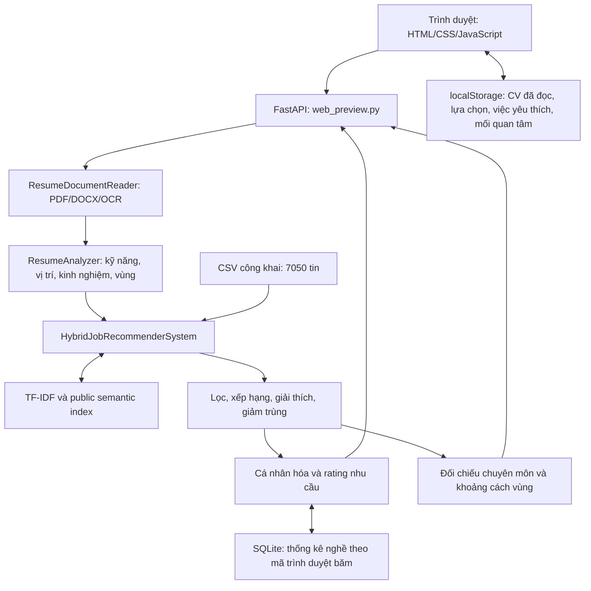
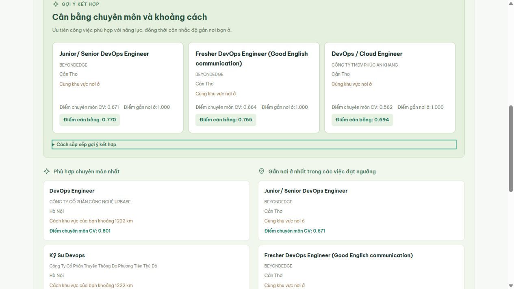
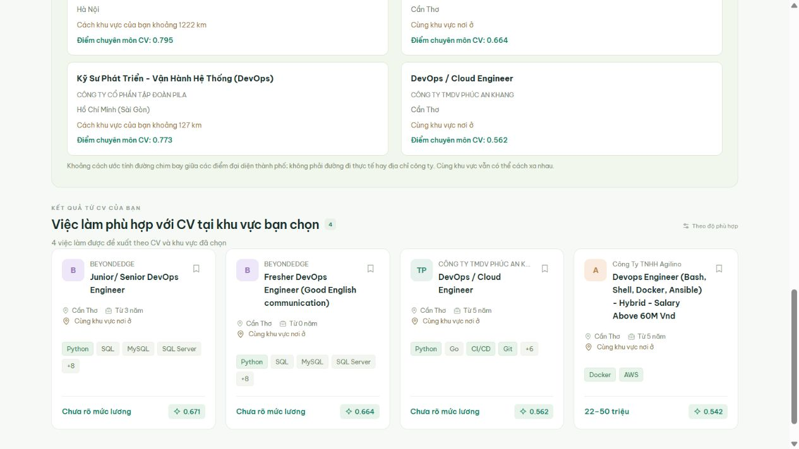

# Hồ sơ bàn giao để viết báo cáo đồ án — Hệ gợi ý việc làm trực tuyến (JobVista)

**Ngày cập nhật:** 11/11/2026; giữ toàn bộ lịch sử từ ngày bắt đầu đồ án.

**Môn học:** Trí tuệ nhân tạo ứng dụng.

**Repository:** [TienMoi79/job-recommender-system](https://github.com/TienMoi79/job-recommender-system).

**Phiên bản chức năng được đối chiếu:** commit [`7206ab7`](https://github.com/TienMoi79/job-recommender-system/commit/7206ab73c2208ca79b94661947fe0e7654c9a436), ngày 11/11/2026. Bao gồm nhóm gợi ý kết hợp ở commit [`329c59e`](https://github.com/TienMoi79/job-recommender-system/commit/329c59ed9168eb0afac84a9c98d84c808f1a3304).

**Mục đích:** giúp thành viên chưa tham gia phát triển hiểu toàn bộ quá trình, đọc mã nguồn, chạy demo và viết báo cáo đúng với sản phẩm đã làm.

**Những điểm mới cần đưa vào báo cáo lần này:**

- Nhóm **Cân bằng chuyên môn và khoảng cách** lên đầu, dùng điểm thử nghiệm 70% CV + 30% độ gần; hai nhóm chuyên môn/gần nơi ở nằm bên dưới để đối chiếu.
- Danh sách kết quả chính phía dưới đổi tên thành **Việc làm phù hợp với CV tại khu vực bạn chọn**; chọn tất cả địa điểm thì ghi **Việc làm phù hợp với CV trên tất cả khu vực**. Có bản tiếng Anh tương ứng.
- Ba nhóm đối chiếu toàn quốc và danh sách chính theo vùng có phạm vi/cách xếp hạng khác nhau; không gọi mọi điểm hiển thị là điểm cân bằng.
- Đã chạy toàn bộ 91 test Python, 24 test JavaScript và notebook Lab 3; đã kiểm tra giao diện Việt/Anh và màn hình điện thoại. Giữ nguyên giới hạn đánh giá pilot trên 500 tin.

Tài liệu này tổng hợp yêu cầu trong cuộc trao đổi, lịch sử Git và mã nguồn hiện có; không phải bản chép nguyên văn hội thoại hay bản báo cáo theo mẫu của trường. Thông tin sinh viên, nhóm, giảng viên, lớp, mẫu bìa và biểu mẫu đánh giá cần do nhóm điền theo thực tế. Không tự điền tên thành viên hay tỷ lệ đóng góp chưa được xác nhận.

Các tên tệp trong nội dung tính từ thư mục gốc repository. Liên kết đến mã nguồn/tài liệu được trỏ tới phiên bản GitHub đã đối chiếu để có thể gửi riêng file Markdown cho người khác; ảnh minh chứng được lưu cùng repo và hiển thị khi có Internet. Đây là tài liệu mô tả và bàn giao, không yêu cầu người đọc chạy mọi script sửa dữ liệu.

## Mục lục

1. [Tóm tắt để hiểu đồ án](#1-tóm-tắt-để-hiểu-đồ-án)
2. [Yêu cầu ban đầu và phạm vi cuối cùng](#2-yêu-cầu-ban-đầu-và-phạm-vi-cuối-cùng)
3. [Quá trình phát triển và các lần điều chỉnh](#3-quá-trình-phát-triển-và-các-lần-điều-chỉnh)
4. [Chức năng hiện tại của web](#4-chức-năng-hiện-tại-của-web)
5. [Kiến trúc và công nghệ](#5-kiến-trúc-và-công-nghệ)
6. [Dữ liệu và nguồn trích dẫn](#6-dữ-liệu-và-nguồn-trích-dẫn)
7. [Làm sạch dữ liệu và vận dụng pandas Lab 3](#7-làm-sạch-dữ-liệu-và-vận-dụng-pandas-lab-3)
8. [Đọc và phân tích CV](#8-đọc-và-phân-tích-cv)
9. [Thuật toán gợi ý và công thức tính điểm](#9-thuật-toán-gợi-ý-và-công-thức-tính-điểm)
10. [Ghi nhớ mối quan tâm và gợi ý trang chủ](#10-ghi-nhớ-mối-quan-tâm-và-gợi-ý-trang-chủ)
11. [Rating nhu cầu nghề theo góp ý giảng viên](#11-rating-nhu-cầu-nghề-theo-góp-ý-giảng-viên)
12. [Phù hợp chuyên môn và gần nơi ở](#12-phù-hợp-chuyên-môn-và-gần-nơi-ở)
13. [Sửa lỗi kinh nghiệm, mô tả và tiền lương](#13-sửa-lỗi-kinh-nghiệm-mô-tả-và-tiền-lương)
14. [Đánh giá mô hình và kết quả thực nghiệm](#14-đánh-giá-mô-hình-và-kết-quả-thực-nghiệm)
15. [Kiểm thử phần mềm và bộ CV mẫu](#15-kiểm-thử-phần-mềm-và-bộ-cv-mẫu)
16. [Cấu trúc mã nguồn và API](#16-cấu-trúc-mã-nguồn-và-api)
17. [Cài đặt, chạy web và Jupyter Notebook](#17-cài-đặt-chạy-web-và-jupyter-notebook)
18. [Kịch bản demo và ảnh nên đưa vào báo cáo](#18-kịch-bản-demo-và-ảnh-nên-đưa-vào-báo-cáo)
19. [Lưu trữ, quyền riêng tư, GitHub và backup](#19-lưu-trữ-quyền-riêng-tư-github-và-backup)
20. [Giới hạn và hướng phát triển](#20-giới-hạn-và-hướng-phát-triển)
21. [Gợi ý cấu trúc báo cáo và câu hỏi bảo vệ](#21-gợi-ý-cấu-trúc-báo-cáo-và-câu-hỏi-bảo-vệ)
22. [Tài liệu tham khảo và bảng kiểm trước khi nộp](#22-tài-liệu-tham-khảo-và-bảng-kiểm-trước-khi-nộp)

## 1. Tóm tắt để hiểu đồ án

JobVista là hệ thống thử nghiệm hỗ trợ tìm việc trong lĩnh vực CNTT. Có hai bài toán chính:

1. **Item-to-item:** khi xem một công việc, gợi ý các công việc tương tự.
2. **User-to-item:** khi tải CV lên, phân tích nội dung và xếp hạng các công việc phù hợp.

Ví dụ, ứng viên có Python, SQL, Power BI và muốn làm Data Analyst tại Hà Nội sẽ nhận các việc có chuyên môn liên quan, trong vùng đã xác nhận. Hệ thống giải thích kỹ năng nào đã thấy/chưa thấy trong CV và xem xét kinh nghiệm. Sau đó, ứng viên có thể so sánh việc phù hợp chuyên môn nhất với việc gần khu vực đang ở nhất.

Phiên bản hiện tại có **7.050 công việc từ nguồn dữ liệu công khai**, không phải 7.050 dòng việc làm tự bịa. Có giao diện web Việt/Anh, đọc CV Word/PDF/ảnh, lưu hồ sơ cục bộ, ghi nhớ mối quan tâm tìm kiếm và bổ sung rating nhu cầu nghề. Sau khi ghép CV, nhóm gợi ý kết hợp chuyên môn–khoảng cách được ưu tiên hiển thị trước các nhóm đối chiếu riêng; danh sách chính bên dưới vẫn theo vùng muốn làm việc. Hai notebook phục vụ trình bày thuật toán theo yêu cầu giảng viên.

Đây là **hệ gợi ý dựa trên nội dung kết hợp một số tín hiệu hành vi và quy tắc xếp hạng**. Hệ thống chưa phải nền tảng tuyển dụng vận hành thực tế: chưa có tài khoản, nhà tuyển dụng, nộp đơn hay xác minh tin còn tuyển.

## 2. Yêu cầu ban đầu và phạm vi cuối cùng

Yêu cầu khởi đầu chia thành bốn giai đoạn theo cách làm lặp, nhận góp ý rồi cải tiến:

| Giai đoạn | Yêu cầu ban đầu | Kết quả đã làm |
|---|---|---|
| 1 — Dữ liệu | Dùng pandas tạo ít nhất 15 việc IT và 3 đoạn CV | Tạo 20 việc giả lập, 3 CV văn bản, thêm bản dữ liệu tiếng Việt |
| 2 — AI Engine | Python OOP, embedding/TF-IDF, cosine, hai hàm gợi ý | Có `JobRecommenderSystem`, hai vectorizer và hai hàm đúng yêu cầu |
| 3 — Đánh giá | Bổ sung sau giai đoạn 1–2 | Đã có benchmark pilot, metrics, so sánh A/B/C, kết quả lưu để tái lập |
| 4 — Giao diện | Ban đầu dự kiến Streamlit | Đã làm Streamlit, sau đó chuyển sang JobVista dùng FastAPI + HTML/CSS/JavaScript; giao diện cũ đã gỡ |

Các yêu cầu phát sinh đã được đưa vào sản phẩm: Jupyter Notebook; upload CV; lọc vùng; dữ liệu có nguồn; 10 CV mẫu; giải thích kết quả; nhận diện kinh nghiệm; ghi nhớ hồ sơ và sở thích; rating từ Lab 3; đối chiếu khoảng cách; sửa trình bày mô tả và đơn vị lương.

Mã nguồn dùng class, kế thừa và các module có nhiệm vụ riêng; có comment/docstring tiếng Việt. Cách làm mang tính **phát triển lặp theo backlog và phản hồi**, không có bằng chứng để viết rằng nhóm đã tổ chức đầy đủ Scrum với sprint planning, daily meeting và velocity chính thức.

## 3. Quá trình phát triển và các lần điều chỉnh

Các ngày bên dưới dựa vào lịch sử commit, giúp người viết phân biệt phiên bản cũ và hiện tại.

| Thời điểm | Công việc và phản hồi | Kết quả/commit tiêu biểu |
|---|---|---|
| 04/10/2026 | Xây nền tảng dữ liệu giả lập và AI Engine | `55ee43e`: mock, hai cách vector hóa, gợi ý tương tự/ghép CV, kiểm thử |
| 04/10/2026 | Bổ sung dữ liệu Việt, tên tệp theo yêu cầu `jobs_vie.cvs` | `ada0204`, `432196c`; `.cvs` là tên lịch sử, nội dung vẫn dạng CSV |
| 04/10/2026 | Giảng viên yêu cầu chạy bằng Jupyter Notebook | `2b1fa66`: notebook có giải thích và kết quả thực thi |
| 09/10/2026 | Tiếp nhận giao diện được chuẩn bị riêng, kết nối phần AI | `5c191b6`: tích hợp giao diện Streamlit thời điểm đó |
| 14/10/2026 | Yêu cầu đổi Việt/Anh toàn trang, bỏ “Về đồ án”, giải thích tùy chọn dễ hiểu | `78e1365`, `6a41f02`: sửa ngôn ngữ và cách diễn đạt |
| 14/10/2026 | Chuyển từ nhập CV sang tải ảnh/PDF/Word, đọc vùng, tăng dữ liệu có nguồn | `6f80f95`, `2d6ebc1`: bộ đọc CV và catalog 500 tin, bản hiển thị Việt/Anh |
| 16/10/2026 | Muốn giao diện tương tác mới, hiện đại hơn | `16d4433`: JobVista, FastAPI và frontend HTML/CSS/JavaScript |
| 16/10/2026 | Bỏ nút “Xem tin gốc” vì đó là link dataset để báo cáo | `47a5d00`: không đưa link dataset lên luồng tìm việc của người dùng |
| 16/10/2026 | Chi tiết chỉ hiện khi chọn tin; chọn lại để tắt; tận dụng khoảng trống | `a471390`, `a668c9a`: bảng đóng/mở; khi đóng hiện 4 thẻ mỗi hàng trên màn hình rộng |
| 16/10/2026 | Cần 10 CV mẫu và 5 cải tiến thuật toán | `e757c03`, `c00eac1`: bộ CV đa định dạng, hybrid và đánh giá pilot |
| 16/10/2026 | Phát hiện “kinh nghiệm chưa rõ” dù yêu cầu ghi tối thiểu 2 năm | `ab4eddf`: đọc thêm yêu cầu/JD, phục hồi 67 tin trên catalog 500 |
| 17/10/2026 | Bạn clone repo chạy `streamlit run app.py` nên thấy giao diện cũ | `70dadca`: gỡ Streamlit; thống nhất `python web_preview.py`, cổng 8000 |
| 20/10/2026 | Lưu CV để gợi ý trang chủ; ban đầu có bảng tìm kiếm đã lưu | `766d5de`: thêm lưu cục bộ và cá nhân hóa |
| 20/10/2026 | Người dùng làm rõ không muốn thấy lịch sử/nút lưu tìm kiếm | `d8c391e`: ghi nhớ tìm kiếm ngầm trong logic gợi ý, bỏ bảng/nút khỏi UI |
| 05/11/2026 | Góp ý thầy: tăng dữ liệu, vận dụng pandas/rating Lab 3, xử lý việc xa nhà | `8d07e61`: 7.050 tin, rating nhu cầu và bảng so sánh chuyên môn/khoảng cách |
| 05/11/2026 | Phát hiện mô tả dồn đoạn, lương nghìn và số trần “105” | `9b51bad`: rà 7.050 tin, phục hồi bố cục và chuẩn hóa lương có bằng chứng |
| 10/11/2026 | Kiểm tra GitHub, đối chiếu chức năng với nền tảng tuyển dụng và tổng hợp bàn giao | Nhánh `main` đã có bản chức năng `9b51bad`; tài liệu này ghi lại trạng thái để viết báo cáo |
| 11/11/2026 | Thầy yêu cầu kết hợp chuyên môn và khoảng cách, đưa nhóm kết hợp lên đầu | `329c59e`: backup 11 tệp trước sửa; bổ sung điểm 70% CV + 30% độ gần, giữ hai nhóm cũ phía dưới; không bịa điểm khi thiếu nơi ở |
| 11/11/2026 | Làm rõ vai trò danh sách dưới ba nhóm gợi ý | `7206ab7`: đổi tiêu đề danh sách CV theo vùng đã chọn/tất cả khu vực, mô tả số kết quả và bản tiếng Anh; không thay thuật toán |

Trong quá trình làm cũng có yêu cầu dọn các thư mục lab lưu nhầm khỏi Project. Phạm vi dữ liệu ứng dụng không dùng bài lab phim/sách; Lab 3 chỉ được tham khảo cách xử lý pandas và công thức rating. Không ghi tên ba thư mục đã dọn nếu không có chứng cứ để xác nhận.

## 4. Chức năng hiện tại của web

### 4.1. Khám phá và tìm kiếm việc làm

- Tìm bằng chức danh, kỹ năng hoặc công ty; lọc theo địa điểm, lĩnh vực, kinh nghiệm và nhóm nghề hiển thị.
- Xem danh sách, số kết quả và phân trang; tìm kiếm/lọc cập nhật bằng JavaScript gọi API, không cần tải lại toàn trang.
- Mỗi trang danh sách có 8 tin. Khi đóng chi tiết, màn hình rộng có 4 thẻ một hàng; màn hình vừa 2 thẻ, nhỏ 1 thẻ.
- Thẻ có công ty, chức danh, địa điểm, kinh nghiệm, kỹ năng và lương đã chuẩn hóa.
- Bấm một tin mở chi tiết, bấm lại cùng tin để đóng; có nút X và phím Escape. Chọn tin khác đổi nội dung.
- Xem mô tả, yêu cầu và việc tương tự. Không có nút ứng tuyển giả hoặc link dataset được gọi là “tin tuyển dụng gốc”.

### 4.2. Tìm việc với CV

1. Chọn một tệp CV được hỗ trợ.
2. Đọc/trích xuất văn bản; dùng OCR nếu là ảnh hoặc PDF scan.
3. Kiểm tra và sửa nội dung, nơi muốn làm việc, nơi ở và số năm kinh nghiệm.
4. Bấm tìm công việc phù hợp.
5. Xem nhóm kết hợp trước, rồi hai nhóm đối chiếu chuyên môn/gần nơi ở và danh sách kết quả chính theo vùng đã chọn.
6. Chọn một công việc để xem chi tiết, sáu thành phần điểm chuyên môn, kỹ năng đã thấy/chưa thấy trong CV và lý do phù hợp.

Kinh nghiệm là tín hiệu giảm điểm mềm, không tự loại tất cả ứng viên thiếu năm. Vùng muốn làm là ràng buộc cho danh sách chính; không có việc thì báo rỗng thay vì đưa tin ở tỉnh khác vào cho đủ số lượng.

**Cách đọc kết quả hiện tại, từ trên xuống:**

| Phần hiển thị | Phạm vi | Cách xếp hạng/vai trò |
|---|---|---|
| Cân bằng chuyên môn và khoảng cách | Toàn quốc, trong các việc đạt ngưỡng CV và có khoảng cách xác định | `B = 0,70×điểm CV + 0,30×điểm gần`; tối đa 3 gợi ý |
| Phù hợp chuyên môn nhất | Pool việc đạt ngưỡng trên toàn quốc | Ưu tiên điểm CV; không giảm điểm chuyên môn chỉ vì xa |
| Gần nơi ở nhất trong các việc đạt ngưỡng | Pool việc đạt ngưỡng có khoảng cách xác định trên toàn quốc | Ưu tiên khoảng cách, sau đó điểm CV khi cùng khoảng cách |
| Việc làm phù hợp với CV tại khu vực bạn chọn | Vùng muốn làm việc đã xác nhận; hoặc mọi vùng nếu chọn tất cả | Danh sách chính, điểm CV và rating nhu cầu khi đủ mẫu; chưa áp dụng công thức cân bằng 70/30 |

Ví dụ CV ở Cần Thơ nhưng chọn muốn làm TP.HCM: phần đối chiếu phía trên vẫn có thể đưa ra công việc tại Cần Thơ hoặc Hà Nội để người dùng cân nhắc; danh sách chính phía dưới chỉ lấy việc tại vùng TP.HCM. Số 24 trong ảnh demo là số gợi ý đã trả về ở lượt đó (web yêu cầu tối đa 24), không phải khẳng định chỉ có đúng 24 tin liên quan trong toàn bộ catalog. Thẻ danh sách hiển thị điểm chuyên môn CV; điểm nhu cầu là tầng sắp xếp riêng khi đủ mẫu.

Tiêu đề bản Anh là **Jobs matching your CV in your selected area** hoặc **Jobs matching your CV across all areas**. Dòng đếm kết quả cũng nói rõ gợi ý từ CV và phạm vi vùng, thay vì chỉ ghi “phù hợp bộ lọc”. Đổi tên này chỉ áp dụng cho danh sách CV; trang khám phá chung vẫn dùng tên riêng của trang đó.

### 4.3. Hồ sơ, việc đã lưu và trang chủ cá nhân

- Tự lưu văn bản CV đã đọc và lựa chọn của hồ sơ vào trình duyệt sau khi đọc thành công; không lưu tệp gốc.
- Cập nhật hồ sơ, thay CV, xóa hồ sơ; đọc tệp mới thất bại thì không xóa hồ sơ tốt đang có.
- Lưu/bỏ lưu công việc theo `Job_ID`, xem lại trên cùng trình duyệt.
- Có CV: trang chủ có mục **Phù hợp với bạn**. Chưa có CV nhưng có hành vi tìm kiếm: có **Có thể bạn quan tâm**.
- Tìm kiếm được ghi nhớ ngầm, **không có bảng “Tìm kiếm đã lưu” hay nút “Lưu tìm kiếm này”** trên UI hiện tại.

### 4.4. Việt/Anh

Đổi ngôn ngữ cập nhật giao diện, nhãn, thông báo và phần dữ liệu hiển thị. Hai ngôn ngữ dùng cùng `Job_ID`; không phải hai catalog độc lập. Với nguồn chưa có bản dịch, hệ thống dùng tóm tắt có cấu trúc, **không tuyên bố đã dịch nguyên văn toàn bộ JD bằng mô hình dịch**. Tên công nghệ và tên riêng có thể được giữ nguyên theo tính chất dữ liệu.

## 5. Kiến trúc và công nghệ



| Thành phần | Công nghệ/vai trò |
|---|---|
| Ngôn ngữ chính | Python; xử lý OOP, NLP, dữ liệu và API |
| Dữ liệu | pandas, NumPy; PyArrow để đọc nguồn Parquet từng batch |
| Baseline từ khóa | scikit-learn TF-IDF và cosine similarity; SciPy sparse matrix |
| Embedding | Sentence Transformers, Transformer đa ngôn ngữ chạy CPU |
| Web backend | FastAPI, Uvicorn |
| Frontend | HTML, CSS, JavaScript thuần; không bắt buộc Node.js để chạy web |
| Đọc tệp | pypdf, pypdfium2, python-docx, Pillow |
| OCR | RapidOCR + ONNX Runtime, xử lý cục bộ |
| Thống kê rating | SQLite trên máy/server đang chạy |
| Trình bày học thuật | Jupyter Notebook |
| Kiểm thử | Python unittest; bộ kiểm thử JavaScript bằng Node.js test runner |
| Quản lý phiên bản | Git và GitHub |

Frontend và API được phục vụ từ một tiến trình Python ở cổng 8000; không cần khởi chạy riêng frontend dev server. Đây là web có tương tác phía client; chưa có WebSocket hay hệ thống chat thời gian thực.

**Thiết kế OOP:** `TextVectorizer` là lớp trừu tượng; `TfidfTextVectorizer` và `SentenceTransformerVectorizer` hiện thực cùng giao diện. `HybridJobRecommenderSystem` kế thừa hệ gợi ý nền tảng; các lớp đọc CV, phân tích hồ sơ, xử lý gần trùng, cá nhân hóa và rating tách nhiệm vụ để dễ kiểm tra và mở rộng.

## 6. Dữ liệu và nguồn trích dẫn

### 6.1. Ba loại dữ liệu phải phân biệt trong báo cáo

| Loại | Quy mô | Mục đích |
|---|---:|---|
| Mock data ban đầu | 20 việc + 3 đoạn CV | Minh họa hai hàm nền tảng, học thuật toán và chạy demo nhẹ |
| Catalog web hiện tại | 7.050 việc | Dữ liệu chính để sử dụng web và notebook khi chạy lại trên catalog mới |
| Benchmark pilot đóng băng | 500 việc + 30 CV văn bản giả lập | Đánh giá A/B/C; 10 CV dev và 20 CV test |
| Bộ tệp CV thử upload | 10 hồ sơ × 3 định dạng = 30 tệp | Kiểm tra đọc Word/PDF/ảnh; không phải 30 ứng viên độc lập |

Tệp chính là [`data/jobs_catalog.csv`](https://github.com/TienMoi79/job-recommender-system/blob/7206ab73c2208ca79b94661947fe0e7654c9a436/data/jobs_catalog.csv). File có **7.050 dòng dữ liệu và 42 cột** ở phiên bản được đối chiếu; một dòng logic CSV có thể chứa nhiều dòng văn bản trong dấu nháy. Không dùng số dòng vật lý của tệp để kết luận số việc làm.

Tên `data/jobs_vie.cvs` thuộc lịch sử mẫu 20 tin theo yêu cầu ban đầu. Trên máy làm việc hiện còn thay đổi cục bộ liên quan tên `jobs_vie.csv`/`jobs_vie.cvs`, tách khỏi bản nâng cấp web đã push. Không dùng tệp mẫu này để mô tả quy mô catalog đang chạy và không tự khôi phục/xóa thay đổi cục bộ của người dùng.

### 6.2. Nguồn việc làm

- Dataset: [TiniX AI — Vietnamese Job Descriptions](https://huggingface.co/datasets/tinixai/vietnamese-job-descriptions).
- Snapshot đã ghim: [`679c3a17347ff6ce769d9bf510c122a087493cf6`](https://huggingface.co/datasets/tinixai/vietnamese-job-descriptions/tree/679c3a17347ff6ce769d9bf510c122a087493cf6).
- File nguồn: [data.parquet tại snapshot đã dùng](https://huggingface.co/datasets/tinixai/vietnamese-job-descriptions/resolve/679c3a17347ff6ce769d9bf510c122a087493cf6/data.parquet).
- Giấy phép dữ liệu: [CC BY-NC 4.0](https://creativecommons.org/licenses/by-nc/4.0/); ghi công nguồn, mục đích đồ án phi thương mại. Không suy ra giấy phép dữ liệu là giấy phép cho toàn bộ mã nguồn.
- Bộ nguồn được quét có **606.878 bản ghi**. Sau tiền lọc còn 14.373 bản ghi; catalog bàn giao có 7.050 tin, **3.594 công ty, 24 nhóm vùng chính**.
- Nguồn còn dữ liệu nên chưa cần ghép thêm dataset khác. Chỉ giữ tập con đạt quy tắc cho bài toán IT; không đưa toàn bộ 606.878 bản ghi lên giao diện.
- Đây là snapshot lịch sử; **chưa xác minh các tin còn tuyển**. Link `Source_URL` dẫn tới bản ghi dataset, không phải cam kết có trang ứng tuyển hoạt động.

Thống kê/nguồn/checksum: [`data/catalog_manifest.json`](https://github.com/TienMoi79/job-recommender-system/blob/7206ab73c2208ca79b94661947fe0e7654c9a436/data/catalog_manifest.json). Giải thích đầy đủ: [`data/DATA_SOURCE.md`](https://github.com/TienMoi79/job-recommender-system/blob/7206ab73c2208ca79b94661947fe0e7654c9a436/data/DATA_SOURCE.md).

### 6.3. Cấu trúc các trường

| Nhóm | Trường tiêu biểu | Ý nghĩa |
|---|---|---|
| Bắt buộc từ đề bài | `Job_ID`, `Title`, `Skills`, `Experience_Years`, `Domain`, `Job_Description` | Định danh và nội dung dùng cho gợi ý |
| Hồ sơ doanh nghiệp/tin | `Company`, `Location`, `Requirements`, `Employment_Type` | Thông tin hiển thị và so khớp |
| Kinh nghiệm | `Experience_Known`, `Experience_Text`, `Experience_Source`, `Experience_Evidence` | Phân biệt chưa rõ/0 năm và lưu bằng chứng suy ra |
| Chuyên môn/vùng | `Role_Code`, `Region_Codes`, `Primary_Region` | Mã nhóm nghề, danh sách vùng và vùng chính |
| Ngôn ngữ | `Title_EN`, `Domain_EN`, `Job_Description_EN`, `Requirements_EN`, `Company_EN`, `Salary_EN` | Nội dung/nhãn tiếng Anh |
| Mô tả dễ đọc | `Job_Description_Display`, `Requirements_Display` | Bản có cấu trúc xuống dòng, tách khỏi văn bản NLP |
| Lương | `Salary`, `Salary_Original`, `Salary_Status`, `Salary_Currency`, `Salary_Period`, `Salary_Min`, `Salary_Max`, `Salary_Evidence` | Nhãn chuẩn hóa, nguồn gốc, đơn vị/kỳ và bằng chứng |
| Truy vết | `Source_Dataset`, `Source_Revision`, `Source_Row_ID`, `Source_Row_Index`, `Source_URL`, `Source_License`, `Content_Fingerprint` | Tái lập và kiểm tra nguồn |

Các trường kỹ năng/nhóm nghề/vùng có phần được suy ra bằng từ điển alias và quy tắc. Không mô tả chúng như nhãn hoàn hảo do nhà tuyển dụng xác nhận.

**Phân bố đáng chú ý:** Hà Nội 3.794 tin, TP.HCM 2.685 tin, Đà Nẵng 113 tin; Nha Trang/Khánh Hòa 12 tin. Dữ liệu lệch về hai thành phố lớn. 24 vùng là nhóm địa điểm được hệ thống nhận diện, không phải danh sách đầy đủ đơn vị hành chính Việt Nam.

## 7. Làm sạch dữ liệu và vận dụng pandas Lab 3

Pipeline chính ở [`expand_job_catalog.py`](https://github.com/TienMoi79/job-recommender-system/blob/7206ab73c2208ca79b94661947fe0e7654c9a436/expand_job_catalog.py):

1. Đọc Parquet theo batch **4.096 dòng**, không nạp đồng thời toàn bộ nguồn dài vào RAM.
2. Dùng pandas điền thiếu, chuẩn hóa chuỗi và mặt nạ `str.contains` để tiền lọc tin IT.
3. Yêu cầu mô tả đủ dài (ít nhất 160 ký tự), ít nhất hai kỹ năng được nhận diện, có vùng và công ty hợp lệ.
4. Loại công ty trống/nhãn lỗi, bản ghi trùng và kinh nghiệm bất thường; chuẩn hóa kỹ năng, nhóm nghề, vùng.
5. Dùng fingerprint loại trùng tuyệt đối; ghép các batch bằng `concat`, chuyển trường phù hợp sang `category`, thống kê bằng `value_counts`.
6. Giữ 500 ID đầu của catalog cũ, thêm **6.550** tin; không nhân bản dòng để tăng dữ liệu.
7. Lưu CSV, manifest, phân bố và SHA-256 để kiểm chứng.

`build_job_catalog.py` là công cụ lịch sử chọn bản 500; không chạy công cụ đó đè lên catalog 7.050 khi chỉ muốn sử dụng web. `expand_job_catalog.py` phục vụ mở rộng/tái tạo, người clone thông thường chỉ cần dùng CSV đã bàn giao.

Phần vận dụng Lab 3 không dừng ở mở CSV: xử lý nguồn theo batch; sử dụng các phép biến đổi pandas; làm sạch tương tác, giữ bản ghi gần nhất, `explode`, `groupby`, `merge` để tính rating. Không đưa dữ liệu phim/sách của lab vào catalog việc làm.

## 8. Đọc và phân tích CV

### 8.1. Đọc tài liệu

Lớp [`ResumeDocumentReader`](https://github.com/TienMoi79/job-recommender-system/blob/7206ab73c2208ca79b94661947fe0e7654c9a436/cv_documents.py) nhận byte của tệp và trả văn bản cùng thông tin cách đọc:

| Định dạng | Cách xử lý |
|---|---|
| PDF có chữ | Trích xuất text trực tiếp bằng pypdf |
| PDF scan/ít chữ | Render trang bằng pypdfium2, chạy OCR cục bộ |
| DOCX | Đọc đoạn, bảng, header/text box; tài liệu không có chữ có thể đọc ảnh nhúng |
| PNG/JPG/JPEG/WEBP/TIFF | Dùng Pillow chuẩn bị ảnh, RapidOCR nhận chữ |

Giới hạn có kiểm tra: **15 MB/tệp**, tối đa **20 trang/khung ảnh**, tối đa **60.000 ký tự**. `.doc` cũ cần lưu thành `.docx`; PDF khóa mật khẩu cần bỏ mật khẩu. Tệp hỏng/không hỗ trợ/quá giới hạn được trả thông báo phù hợp ngôn ngữ.

OCR chỉ nhận chữ, không phải phần tự đánh giá độ phù hợp. Đọc xong mới đưa text sang bước NLP và xếp hạng. Chữ mờ, bố cục nhiều cột hoặc tiếng Việt có thể làm OCR sai; người dùng được xem và sửa nội dung trước khi ghép việc.

### 8.2. Phân tích hồ sơ

[`ResumeAnalyzer`](https://github.com/TienMoi79/job-recommender-system/blob/7206ab73c2208ca79b94661947fe0e7654c9a436/resume_profile.py) và các module kinh nghiệm/địa điểm nhận diện:

- Vị trí muốn ứng tuyển, nhóm nghề và lĩnh vực liên quan.
- Kỹ năng qua alias Việt/Anh và ranh giới từ, tránh Java bị trộn với JavaScript, C++ bị trộn C#.
- Số năm kinh nghiệm được nêu rõ; không tự cộng các dự án có thể trùng thời gian.
- Nơi muốn làm việc; ưu tiên dòng nguyện vọng hơn địa chỉ liên hệ.
- Nơi ở hiện tại, đọc riêng để đối chiếu khoảng cách.

Không suy kinh nghiệm từ tuổi hay năm tốt nghiệp; không dùng tên, giới tính hoặc ảnh chân dung làm điểm phù hợp. Không nhận diện được/nhận diện mâu thuẫn thì ghi chưa rõ, cho người dùng xác nhận. **“0 năm” là thông tin đã biết, khác “chưa rõ”.**

## 9. Thuật toán gợi ý và công thức tính điểm

### 9.1. Vector hóa và cosine similarity

**TF-IDF:** biểu diễn từ/cụm từ quan trọng. Cấu hình dùng unigram + bigram, `sublinear_tf=True`, chuẩn hóa L2; bảo vệ token công nghệ như C++, C#, .NET, Node.js. Chỉ fit vocabulary/IDF trên việc làm, sau đó transform CV vào cùng không gian; không fit lại vocabulary trên từng CV.

**Semantic embedding:** mô hình pretrained `sentence-transformers/paraphrase-multilingual-MiniLM-L12-v2`, vector 384 chiều. Hybrid ghim revision `e8f8c211226b894fcb81acc59f3b34ba3efd5f42`. Văn bản dài chia theo token, encode từng đoạn, lấy trung bình và chuẩn hóa L2. Chạy CPU, giới hạn tối đa 4 luồng Torch trong môi trường triển khai này.

Đồ án sử dụng suy luận từ mô hình có sẵn; **chưa huấn luyện/fine-tune Transformer**. Fit TF-IDF không đồng nghĩa huấn luyện một mô hình ngôn ngữ lớn.

```text
cosine(A, B) = (A · B) / (||A|| × ||B||)
```

Cosine đo góc giữa vector. Điểm dùng để xếp hạng, không phải xác suất được tuyển. Nhánh hybrid chặn cosine semantic âm về 0 trước khi kết hợp.

### 9.2. Hai hàm của hệ nền tảng

[`JobRecommenderSystem`](https://github.com/TienMoi79/job-recommender-system/blob/7206ab73c2208ca79b94661947fe0e7654c9a436/job_recommender.py):

```python
recommend_similar_jobs(job_id, top_n=5)
match_cv_to_jobs(cv_text, top_n=5)
```

Cả hai còn hỗ trợ tham số `location` ở phiên bản mở rộng. Hàm thứ nhất so vector của tin đang xem với các tin khác, loại chính tin đó; tính một vector điểm 1×N thay vì lưu sẵn toàn bộ ma trận N×N. Hàm thứ hai phân tích CV, lọc vùng rồi dùng bốn điểm cosine:

```text
Baseline_CV = 0,25 × Title + 0,35 × Skills
            + 0,15 × Domain + 0,25 × Job_Description
```

Hai baseline A/B trong đánh giá lần lượt dùng TF-IDF và semantic cho cơ chế nền tảng này. Kết quả được sắp giảm dần; trường hợp đồng điểm dùng `Job_ID` để thứ tự ổn định. Đầu vào rỗng, ID không tồn tại và `top_n` không hợp lệ được kiểm tra.

### 9.3. Năm cải tiến phiên bản 2

Sau khi người dùng yêu cầu backup rồi triển khai, năm nhóm cải tiến là:

1. Kết hợp từ khóa và ngữ nghĩa thay vì chỉ một cách biểu diễn.
2. Đối chiếu kinh nghiệm có cấu trúc, giảm điểm mềm.
3. Giải thích kỹ năng đã thấy/chưa thấy, điều kiện bắt buộc/ưu tiên và vị trí.
4. Giảm gần trùng và điều chỉnh đa dạng công ty có điều kiện.
5. Đánh giá có thể tái lập qua A/B/C và metrics xếp hạng.

[`HybridJobRecommenderSystem`](https://github.com/TienMoi79/job-recommender-system/blob/7206ab73c2208ca79b94661947fe0e7654c9a436/hybrid_recommender.py) dùng sáu thành phần:

| Thành phần | Trọng số gốc | Cách hiểu |
|---|---:|---|
| Lexical | 0,15 | Cosine TF-IDF của nội dung phù hợp để so khớp |
| Semantic | 0,25 | Tương đồng ngữ nghĩa đa ngôn ngữ |
| Skills | 0,30 | Mức kỹ năng hai phía khớp nhau, có trọng số điều kiện |
| Title | 0,15 | Nhóm nghề và quan hệ các nghề gần nhau |
| Domain | 0,05 | Lĩnh vực/chuyên môn phù hợp |
| Experience | 0,10 | Kinh nghiệm ứng viên so với cận dưới yêu cầu |

```text
S_CV = tổng(w_hiệu_lực × điểm_thành_phần)
```

Khi thiếu thông tin một thành phần, bỏ trọng số phần đó rồi chuẩn hóa phần còn lại về tổng 1. Thiếu model/đang làm nóng thì semantic không được giả điểm; kết quả ghi `hybrid-lexical`, không gọi đó là kết quả đã dùng ngữ nghĩa.

### 9.4. Điểm kỹ năng và kinh nghiệm

Kỹ năng trong tin: bắt buộc có trọng số 2; được nhắc thông thường 1; ưu tiên 0,5. Chỉ gắn nhãn bắt buộc khi câu nguồn có bằng chứng rõ, không mặc định mọi kỹ năng metadata đều bắt buộc.

```text
JobCoverage = trọng số kỹ năng trùng / tổng trọng số kỹ năng tin
CV_Coverage = số kỹ năng trùng / số kỹ năng nhận diện trong CV
Penalty = 1 - 0,5 × (số kỹ năng bắt buộc chưa thấy / số kỹ năng bắt buộc)
Skills = (0,6 × CV_Coverage + 0,4 × JobCoverage) × Penalty
```

Không có nhãn bắt buộc thì `Penalty=1`. Trên giao diện viết “chưa thấy trong CV”, không khẳng định người đó không có kỹ năng.

Với `c` là năm kinh nghiệm ứng viên, `r` là mức tối thiểu của tin:

```text
Experience = exp(-max(0, r-c)/2)
```

Đạt/vượt yêu cầu có điểm 1; thiếu 2 năm có điểm khoảng 0,368. Nếu thiếu dữ liệu kinh nghiệm thì bỏ thành phần này. Không phạt ứng viên quá nhiều năm bằng quy tắc “overqualified” tự suy ra.

### 9.5. Lọc và giảm gần trùng

- Danh sách chính giữ vùng muốn làm; ý định vị trí được ghi rõ có thể loại nghề xung đột. Không coi mọi nghề chỉ được nhắc trong CV là nguyện vọng cứng.
- Ngưỡng điểm cơ sở 0,12, kèm điều kiện có tín hiệu nghề/kỹ năng/nội dung; có thể trả ít hơn top-N.
- Gần trùng xét cùng công ty, vùng, cấp bậc, chức danh và phần đầu mô tả; `SequenceMatcher >= 0,88` cho các so sánh liên quan. Không trộn Junior/Senior chỉ vì cùng nhóm nghề.
- Chỉ chọn đại diện trong kết quả, không xóa các dòng nguồn khỏi catalog.
- Ưu tiên tối đa 2 tin/công ty nếu có lựa chọn công ty khác đạt ít nhất 85% điểm của tin cần thay; không hạ mạnh chất lượng chỉ để đủ nhiều công ty.

Với gợi ý việc tương tự của hybrid: có semantic dùng `0,5×Lexical + 0,5×Semantic`; chưa có semantic dùng lexical. Loại nhóm gần trùng của tin đang xem. Không áp nguyên công thức sáu điểm CV cho mọi chức năng.

### 9.6. Cache và hiệu năng

[`PublicSemanticIndex`](https://github.com/TienMoi79/job-recommender-system/blob/7206ab73c2208ca79b94661947fe0e7654c9a436/semantic_index.py) cache **embedding tin công khai**, dùng SHA-256 từ văn bản, model, revision và schema. Không cache văn bản/embedding truy vấn CV. Có warm-up nền; lượt tìm khi index chưa sẵn sàng dùng nhánh lexical có thông báo, lượt sau mới dùng semantic khi sẵn sàng.

Người dùng đổi Việt/Anh không làm mất dữ liệu gốc: các trường `Original_*` phục vụ so khớp và nhóm công ty; trường hiển thị được chọn theo ngôn ngữ. Cải tiến phân nhóm gần trùng giúp tránh so sánh vô ích toàn bộ cặp tin khi catalog lớn hơn.

## 10. Ghi nhớ mối quan tâm và gợi ý trang chủ

Chức năng này được sửa theo đúng ý người dùng: **web tự ghi nhớ để gợi ý, không đưa lịch sử ra thành một bảng trên màn hình**.

- Trình duyệt lưu tối đa 20 bộ điều kiện khác nhau trong 90 ngày.
- Điều kiện gồm từ khóa, vùng, lĩnh vực, kinh nghiệm và nhóm nghề; bỏ truy vấn rỗng.
- Chỉ ghi tìm kiếm có điều kiện và có kết quả; không lưu từng phím gõ.
- Tìm lặp dưới 30 giây không tăng số lượt; ảnh hưởng số lần lặp bị giới hạn.
- Độ quan tâm giảm một nửa sau 14 ngày, để sở thích cũ dần ít ảnh hưởng.

Trong [`SearchInterestRecommender`](https://github.com/TienMoi79/job-recommender-system/blob/7206ab73c2208ca79b94661947fe0e7654c9a436/interest_recommender.py):

```text
Trọng_số_sự_kiện = 2^(-tuổi_sự_kiện/14 ngày) × (1 + ln(số_lượt_đã_giới_hạn_tối_đa_5))
```

Khi có CV và có tín hiệu quan tâm trùng: `S_personal = 0,85×S_CV + 0,15×S_interest`. Không có tín hiệu phù hợp thì giữ điểm CV. Chỉ sắp lại pool đã qua điều kiện CV/vùng, không kéo việc trái nghề vào.

Khi chưa có CV, dùng lịch sử tìm kiếm để gợi ý; ưu tiên vùng của lần tìm gần nhất và không thêm tin không trùng điều kiện. Đây là điểm mối quan tâm, không gọi là mức phù hợp với CV.

Lịch sử gửi theo từng request, không đặt trong bộ nhớ dùng chung giữa người dùng. Không huấn luyện lại Transformer từ hành vi; đây là cá nhân hóa bằng quy tắc trên dữ liệu cục bộ.

## 11. Rating nhu cầu nghề theo góp ý giảng viên

Giảng viên gợi ý phải có rating: có thể để người dùng chấm hoặc dùng code thống kê nghề được quan tâm. Đồ án đã chọn **rating ngầm bằng code**, chưa có giao diện chấm sao thủ công.

### 11.1. Tương tác được ghi nhận

Khi người dùng chủ động ghép CV, hệ thống ghi mã trình duyệt đã băm, các mã nghề nhận diện được và thời gian. Mỗi mã trình duyệt chỉ giữ **nguyện vọng gần nhất trong 30 ngày**; nhiều nghề chia đều tổng trọng số 1. Nhấn tìm lại không được coi là thêm một người mới. Refresh gợi ý trang chủ không ghi thêm lượt nhu cầu.

Mã trình duyệt là actor giả danh, **không phải danh tính người đã xác minh**. 10 actor không nhất thiết là 10 người độc lập. Các bản clone chạy localhost riêng có thống kê riêng; muốn cộng nhiều máy phải dùng cùng server.

### 11.2. Công thức Lab 3 được vận dụng

[`DemandRatingStore`](https://github.com/TienMoi79/job-recommender-system/blob/7206ab73c2208ca79b94661947fe0e7654c9a436/demand_rating.py) dùng pandas `to_numeric → sort_values → drop_duplicates → explode → groupby → merge`.

```text
N = số actor hợp lệ
n = tổng trọng số quan tâm một nghề
K = số nhóm nghề
R = 5 × n/N                 # nhu cầu thô, từ 0 đến 5
C = 5/K                    # prior
m = 5                      # độ mạnh prior
WR = N/(N+m) × R + m/(N+m) × C
```

Ví dụ 8/10 actor chỉ chọn Data Analyst thì `R=4/5`, WR được làm trơn về prior. Đây là **điểm mức quan tâm trong ứng dụng**, không phải chất lượng tin, chất lượng nhà tuyển dụng hay số liệu nhu cầu toàn thị trường.

Khi dưới 5 actor, trọng số rating trong xếp hạng bằng 0. Đủ mẫu:

```text
S_final = 0,9 × S_base + 0,1 × (WR/5)
```

`S_base` là điểm nội dung hoặc điểm cá nhân hóa tùy luồng. Trên trang chủ có CV và có mối quan tâm, các tầng lần lượt là **CV → mối quan tâm → rating**, không cộng thẳng tất cả điểm có thang khác nhau. Không tính rating vào sáu điểm chuyên môn để tránh giải thích sai.

Rating chỉ sắp lại pool hợp lệ đã được truy hồi; nó không mở rộng truy hồi toàn bộ tin, không bỏ điều kiện vùng/nghề. Chưa có thực nghiệm chứng minh thêm rating làm tăng Precision hay NDCG.

## 12. Phù hợp chuyên môn và gần nơi ở

Góp ý của giảng viên: việc phù hợp nhất có thể quá xa ứng viên. Giải pháp giữ riêng hai nhu cầu:

| Thông tin | Mục đích |
|---|---|
| Nơi muốn làm việc | Lọc danh sách chính theo lựa chọn của ứng viên |
| Nơi ở hiện tại | Làm mốc đối chiếu khoảng cách |
| Nhóm cân bằng chuyên môn và khoảng cách | Gợi ý đầu tiên, kết hợp điểm CV và độ gần nơi ở |
| Nhóm phù hợp chuyên môn nhất | Các việc có điểm CV cao trên toàn quốc |
| Nhóm gần nơi ở nhất | Các việc đã đạt ngưỡng phù hợp, xếp gần trước rồi theo điểm CV |

Bảng so sánh mặc định lấy tối đa 3 tin mỗi nhóm; không lấy nơi ứng viên muốn chuyển đến làm địa chỉ nhà. Nếu chưa rõ nơi ở thì không kết luận việc nào gần nhà. Các nhóm so sánh toàn quốc là phần riêng, không trộn tin ngoài vùng vào danh sách chính.

**Bổ sung 11/11/2026:** nhóm kết hợp ở trên cùng, hai nhóm chuyên môn/gần nhà
riêng ở bên dưới. Với khoảng cách vùng d (km), `P = 1/(1+d/50)` và
`B = 0,70×điểm CV + 0,30×P`. Chỉ dùng công việc đã đạt ngưỡng chuyên môn,
có khoảng cách xác định. Không sửa điểm CV, không cộng rating nhu cầu vào
phép cân bằng này. 70/30 và 50 km là cấu hình thử nghiệm, chưa có đánh giá
chứng minh tăng độ chính xác. Thiếu nơi ở hoặc tọa độ thì không tạo điểm kết hợp.
Chi tiết: [BALANCED_RECOMMENDATIONS.md](https://github.com/TienMoi79/job-recommender-system/blob/7206ab73c2208ca79b94661947fe0e7654c9a436/docs/BALANCED_RECOMMENDATIONS.md).

Ví dụ tính tay (khoảng cách giả định để minh họa, không phải một lần đo chất lượng):

| Việc | Điểm CV | Khoảng cách vùng | Điểm gần P | Điểm cân bằng B |
|---|---:|---:|---:|---:|
| A — chuyên môn cao, xa | 0,90 | 1.200 km | 0,040 | 0,642 |
| B — chuyên môn khá, cùng vùng | 0,70 | 0 km tại điểm đại diện | 1,000 | 0,790 |
| C — chuyên môn tốt, gần hơn A | 0,85 | 50 km | 0,500 | 0,745 |

Nhóm kết hợp xếp B, C, A; nhóm chuyên môn riêng vẫn xếp A trước. Nếu B chỉ có điểm CV 0,20 thì điểm cân bằng là 0,44, thấp hơn A: **gần không có nghĩa luôn thắng**. 50 km là tham số làm giảm điểm gần, không phải bán kính loại tin. Điểm cân bằng là một chính sách xếp hạng thử nghiệm, không phải rating nhu cầu, điểm chuyên môn gốc hay xác suất trúng tuyển.

Chưa xác nhận nơi ở thì không tạo gợi ý cân bằng/gần nơi ở; nhóm chuyên môn vẫn có thể có kết quả. Tin chỉ remote hoặc thiếu vùng có tọa độ không bị gán 0 km. Tin nhiều vùng dùng vùng đã biết gần nhất. Không kéo việc trái nghề hoặc không đạt ngưỡng vào chỉ vì gần nhà.

[`job_proximity.py`](https://github.com/TienMoi79/job-recommender-system/blob/7206ab73c2208ca79b94661947fe0e7654c9a436/job_proximity.py) dùng Haversine với bán kính Trái Đất 6.371,0088 km để tính đường chim bay giữa **điểm đại diện vùng/thành phố**. File [`data/region_coordinates.json`](https://github.com/TienMoi79/job-recommender-system/blob/7206ab73c2208ca79b94661947fe0e7654c9a436/data/region_coordinates.json) có 25 điểm đại diện, lấy từ [GeoNames cities15000](https://download.geonames.org/export/dump/cities15000.zip), [CC BY 4.0](https://creativecommons.org/licenses/by/4.0/).

Đây không phải GPS, lộ trình đường bộ hay thời gian đi làm; không có địa chỉ nhà/công ty chính xác. Cùng vùng hiển thị “Cùng khu vực nơi ở”, không diễn giải là đi làm 0 km. Điểm CV không bị sửa để việc gần trông có vẻ giỏi chuyên môn hơn.

## 13. Sửa lỗi kinh nghiệm, mô tả và tiền lương

### 13.1. Kinh nghiệm mâu thuẫn

Trường hợp người dùng phát hiện: Fullstack Java Developer `VN0002` hiển thị chưa rõ nhưng yêu cầu ghi ít nhất 2 năm. Nguyên nhân: chỉ dùng metadata nguồn chưa đủ.

Sửa bằng [`job_experience.py`](https://github.com/TienMoi79/job-recommender-system/blob/7206ab73c2208ca79b94661947fe0e7654c9a436/job_experience.py): ưu tiên metadata rõ; nếu thiếu đọc phần yêu cầu, sau đó phần yêu cầu trong JD gộp; lưu nơi suy ra và đoạn bằng chứng. Không lấy tuổi, năm học, phụ cấp hoặc điều kiện chỉ “ưu tiên” làm yêu cầu tối thiểu.

Bản 500 đã phục hồi 67 tin và còn 67 tin chưa rõ; **catalog 7.050 hiện có 556 tin chưa rõ kinh nghiệm**. Đây là hai mẫu số khác nhau. Nhật ký cũ: `outputs/data_quality/experience_repairs.csv`.

### 13.2. Mô tả dồn thành một đoạn

Không chỉ CSS: nhiều mô tả nguồn đã mất newline. [`job_presentation.py`](https://github.com/TienMoi79/job-recommender-system/blob/7206ab73c2208ca79b94661947fe0e7654c9a436/job_presentation.py) và [`repair_job_presentation.py`](https://github.com/TienMoi79/job-recommender-system/blob/7206ab73c2208ca79b94661947fe0e7654c9a436/repair_job_presentation.py) khôi phục bằng quy tắc: giữ cấu trúc HTML/newline nếu có, tách tiêu đề, bullet, danh sách số, câu dính liền và cụm nhiệm vụ rõ trong dòng quá dài. Bảo vệ URL, Node.js và khoảng số để tránh tách bừa.

Lưu bản dễ đọc vào `Job_Description_Display`, `Requirements_Display`; giữ nguyên văn bản NLP để kết quả gợi ý không đổi chỉ vì trình bày. Frontend hiển thị paragraph, heading, ul/ol; escape nội dung để không chạy HTML/script từ nguồn. Không tuyên bố khôi phục đúng 100% bố cục gốc đã mất.

Rà đủ 7.050 tin: 6.855 mô tả và 5.991 phần yêu cầu có nhiều dòng sau xử lý; số còn lại có thể là nội dung ngắn, không phải bắt buộc mỗi tin đều có nhiều mục.

### 13.3. Chuẩn hóa lương đúng bằng chứng

| Trường hợp | Kết quả sửa | Căn cứ |
|---|---|---|
| KOH YOUNG `VN0005`: `1000 - 2000 nghìn/tuần` | **1–2 triệu/tuần** | Đổi nghìn sang triệu, giữ tuần |
| Khoản lương thật `50 - 300 nghìn/ngày` | **0,05–0,3 triệu/ngày** | Đổi đơn vị, không tự nhân thành tháng |
| ATOMI `VN0142`: metadata `50 - 300 nghìn/ngày` | **Lương thỏa thuận** | Nguồn nêu lương thỏa thuận, 50k/ngày ăn trưa và 300k/tháng gửi xe; metadata ghép nhầm phụ cấp |
| WOORI `VN0059`: `105` | **Chưa rõ mức lương** | 105 triệu/năm trong quyền lợi là bảo hiểm; không đủ căn cứ để coi là lương |
| `15000000 - 50000000 VND MONTH` | **15–50 triệu/tháng** | Có tiền tệ và kỳ rõ |
| USD hợp lệ | Giữ USD và kỳ nguồn | Không tự dùng tỷ giá đoán để đổi sang VND |
| 0, khoảng đảo chiều, số thiếu đơn vị | **Chưa rõ mức lương** | Không tự bịa mức lương |

Lưu `Salary_Original` để đối chiếu; `Salary_Min/Max` dùng **triệu VND** hoặc **USD** theo `Salary_Currency`, không so số giữa tiền tệ/kỳ khác nhau. Giữ dấu dưới/trên/từ/tối đa; không tự thêm “/tháng” khi nguồn không nói.

6.672 nhãn lương khác chuỗi nguồn sau chuẩn hóa không đồng nghĩa 6.672 tin sai lương; phần lớn là thống nhất cách hiển thị. Chi tiết từng tin: [`outputs/data_quality/presentation_audit.csv`](https://github.com/TienMoi79/job-recommender-system/blob/7206ab73c2208ca79b94661947fe0e7654c9a436/outputs/data_quality/presentation_audit.csv); thống kê: [`presentation_summary.json`](https://github.com/TienMoi79/job-recommender-system/blob/7206ab73c2208ca79b94661947fe0e7654c9a436/outputs/data_quality/presentation_summary.json).

Catalog có checksum và `.gitattributes` để Git không đổi byte xuống dòng khi clone Windows/Linux. Snapshot benchmark cũ giữ nguyên nội dung để tránh làm sai đối chiếu đánh giá.

## 14. Đánh giá mô hình và kết quả thực nghiệm

### 14.1. Thiết kế pilot

- Catalog **500 tin được đóng băng**, không phải 7.050: [`data/evaluation/jobs_catalog_500.csv`](https://github.com/TienMoi79/job-recommender-system/blob/7206ab73c2208ca79b94661947fe0e7654c9a436/data/evaluation/jobs_catalog_500.csv).
- 30 CV văn bản giả lập: 10 dev, 20 test. Tập test có 19 truy vấn có nhãn dương, một truy vấn không có việc tại Quảng Ninh.
- Nhãn pilot do trợ lý biên soạn trước so sánh: grade 2 phù hợp cao, grade 1 liên quan cần kiểm tra; chưa có chuyên gia độc lập xác nhận.
- Tin chưa gán nhãn tính 0 nên có thể đánh giá thấp những gợi ý hợp lý. Không lấy điểm mô hình tự tạo thành nhãn chuẩn của chính nó.
- So sánh cùng CV, catalog, vùng, top 5; không chỉnh trọng số theo test. SHA-256 được kiểm tra để phát hiện catalog khác benchmark.

Ba hệ: **A = TF-IDF baseline; B = semantic baseline; C = hybrid phiên bản 2**. Đánh giá này được chạy với semantic thật trên CPU, lưu ngày 16/10/2026 sau sửa kinh nghiệm.

### 14.2. Metrics

| Chỉ số | Ý nghĩa |
|---|---|
| Precision@5 | Số tin có grade ≥1 trong top 5, chia cố định 5 dù trả ít hơn |
| StrictPrecision@5 | Chỉ coi grade 2 là phù hợp |
| Recall@5 | Nhãn dương tìm được / tổng nhãn dương đã biết của truy vấn |
| NDCG@5 | Đánh giá thứ hạng có cấp độ; gain `2^grade−1`, discount `log2(rank+1)` |
| MRR@5 | Nghịch đảo thứ hạng tin phù hợp đầu tiên; không có thì 0 |
| Empty Accuracy | Đúng khi không trả việc cho truy vấn không có việc phù hợp |
| Region Violations | Số kết quả sai vùng đã chọn |
| Near Duplicate Extras | Số bản gần trùng dư trong kết quả |
| Latency | Thời gian truy vấn khi hệ thống đã sẵn sàng, tách khỏi khởi tạo |

Các macro Precision/Recall/NDCG/MRR lấy trên 19 truy vấn dương; truy vấn rỗng đo riêng. Không gọi tỷ lệ tin phù hợp trong số đã trả là Precision@5 nếu mẫu số không còn là 5.

### 14.3. Kết quả đã lưu

| Chỉ số | A TF-IDF | B Semantic | C Hybrid |
|---|---:|---:|---:|
| Precision@5 | 0,7474 | 0,7053 | 0,6316 |
| StrictPrecision@5 | 0,4105 | 0,3789 | 0,4105 |
| Recall@5 | 0,6083 | 0,5830 | 0,4771 |
| NDCG@5 | 0,8456 | 0,7553 | 0,7919 |
| MRR@5 | 0,9386 | 0,9474 | 0,9211 |
| Empty Accuracy | 1/1 | 1/1 | 1/1 |
| Vi phạm vùng | 0 | 0 | 0 |
| Số tin trả trung bình | 4,75 | 4,75 | 3,85 |
| Số công ty trung bình | 4,50 | 4,45 | 3,70 |
| Bản gần trùng dư trung bình | 0,10 | 0,10 | 0,00 |
| Độ trễ trung vị, ms | 35,62 | 258,63 | 288,77 |

Nguồn số liệu: [`outputs/evaluation/test/summary.csv`](https://github.com/TienMoi79/job-recommender-system/blob/7206ab73c2208ca79b94661947fe0e7654c9a436/outputs/evaluation/test/summary.csv), `per_query.csv`, `predictions.json`, `run_metadata.json`; diễn giải ở [`docs/EVALUATION_REPORT.md`](https://github.com/TienMoi79/job-recommender-system/blob/7206ab73c2208ca79b94661947fe0e7654c9a436/docs/EVALUATION_REPORT.md).

**Kết luận đúng:** TF-IDF cao nhất về P@5 và NDCG@5 trên pilot này; hybrid có giải thích và giảm gần trùng nhưng chưa chứng minh cải thiện chất lượng xếp hạng. Hybrid trả ít tin hơn, nên số công ty tuyệt đối giảm; không được kết luận đã tăng độ đa dạng công ty chỉ từ bảng này. Nhãn dương cho các bản gần trùng có thể làm baseline được lợi.

**Không dùng các số trên làm kết quả 7.050 tin hoặc kết quả cải tiến rating/khoảng cách.** Chưa có qrels độc lập cho phiên bản mở rộng. Thời gian khởi tạo cũng không so trực tiếp như cold-start công bằng vì hybrid đã dùng cache tin công khai; latency phụ thuộc máy.

## 15. Kiểm thử phần mềm và bộ CV mẫu

### 15.1. Phạm vi kiểm thử

Python kiểm tra validation, TF-IDF/vector hóa, cosine/ranking, vùng, hybrid, kinh nghiệm, kỹ năng, metrics, catalog/checksum, đọc tài liệu, API, rating, khoảng cách và định dạng lương/mô tả. JavaScript kiểm tra lưu hồ sơ, điều phối request, thay/xóa CV, lỗi storage, thay ngôn ngữ, gợi ý từ lịch sử, giải thích khoảng cách và render nội dung an toàn.

Trạng thái chứng cứ tại lần tổng hợp:

- Sau bổ sung nhóm cân bằng ngày 11/11/2026, đã chạy đạt **toàn bộ 91 test Python** và **24 test JavaScript**; notebook Lab 3 đã chạy lại không có ô lỗi.
- Các test mới kiểm tra lựa chọn kết hợp khác cả hai cực, trường hợp thiếu nơi ở/tọa độ, điểm chuyên môn gốc không đổi, nhiều vùng, đồng điểm, lọc vùng API và thứ tự hiển thị Việt/Anh.
- Đã kiểm tra web/API các tin người dùng chụp: lương tuần KOH, WOORI 105, ATOMI và mô tả có nhiều dòng; kiểm tra trình duyệt phần hiển thị và Việt/Anh.
- Nhóm nên chạy lệnh bên dưới trước khi chụp kết quả nộp; số test và kết quả phải tương ứng phiên bản đang dùng.

Số test phần mềm đạt không phải độ chính xác AI. Test nhẹ có encoder giả lập hoặc tắt semantic để không tải model; thực nghiệm A/B/C với semantic thật là chứng cứ riêng.

### 15.2. Mười CV giả lập để demo

[`data/sample_cvs/`](https://github.com/TienMoi79/job-recommender-system/blob/7206ab73c2208ca79b94661947fe0e7654c9a436/data/sample_cvs/README.md) có Word, PDF có chữ và PNG cho từng hồ sơ; gói tải chung: [`outputs/10_cv_mau_jobvista.zip`](https://github.com/TienMoi79/job-recommender-system/blob/7206ab73c2208ca79b94661947fe0e7654c9a436/outputs/10_cv_mau_jobvista.zip).

| CV | Nghề/nguyện vọng | Điểm cần kiểm tra |
|---|---|---|
| CV01 | Data Analyst — Hà Nội | SQL/Python/Power BI, công việc phân tích dữ liệu |
| CV02 | Backend Python — muốn Hà Nội, đang ở TP.HCM | Tách nơi ở với nơi muốn làm, so sánh việc xa/gần |
| CV03 | Frontend React — Sài Gòn | Chuẩn hóa Sài Gòn thành vùng TP.HCM |
| CV04 | AI Engineer — Đà Nẵng | Nghề và vùng, không tự lấy việc tỉnh khác |
| CV05 | Data Engineer — TP.HCM | Phân biệt với Data Analyst dù cùng Python/SQL |
| CV06 | QA/Tester — Nha Trang | Nhóm Nha Trang/Khánh Hòa |
| CV07 | DevOps — Cần Thơ | Kỹ năng hạ tầng/cloud, không chỉ từ khóa Python |
| CV08 | Embedded — Hải Phòng | C++ và giảm tin gần trùng |
| CV09 | UI/UX, CV tiếng Anh — muốn Nha Trang, ở Đà Nẵng | Đọc tiếng Anh, ưu tiên nguyện vọng |
| CV10 | Cybersecurity — Quảng Ninh | Ca không có tin trong catalog hiện tại, phải trả rỗng đúng vùng |

Mỗi mã chỉ là một hồ sơ ở ba định dạng. Bộ này dùng kiểm thử chức năng, không thay cho bộ benchmark 30 CV độc lập. PDF mẫu có chữ; muốn thử PDF scan thì chuyển ảnh mẫu thành PDF và ghi rõ đã tạo ca scan.

## 16. Cấu trúc mã nguồn và API

### 16.1. Tệp cần đọc

| Tệp/thư mục | Nội dung cần hiểu để viết báo cáo |
|---|---|
| `generate_mock_data.py`, `demo.py` | Tạo 20 việc/3 CV, chạy hai bài toán nền tảng |
| `job_recommender.py` | Tiền xử lý, lớp vectorizer, hệ nền tảng A/B |
| `hybrid_recommender.py` | Sáu điểm, lọc ý định, giải thích, giảm gần trùng/đa dạng |
| `semantic_index.py` | Model revision, cache embedding công khai |
| `cv_documents.py` | Đọc ảnh/PDF/DOCX và OCR |
| `resume_profile.py`, `experience_matching.py`, `locations.py` | Trích xuất CV, kinh nghiệm, vùng |
| `job_experience.py`, `repair_catalog_experience.py` | Chuẩn hóa kinh nghiệm tin và sửa catalog lịch sử |
| `catalog_data.py` | Chọn nội dung hiển thị Việt/Anh, giữ trường gốc |
| `build_job_catalog.py`, `expand_job_catalog.py` | Pipeline catalog 500 lịch sử / mở rộng 7.050 |
| `job_presentation.py`, `repair_job_presentation.py` | Tách mô tả và chuẩn hóa lương có provenance |
| `interest_recommender.py` | Cá nhân hóa theo lịch sử tìm kiếm |
| `demand_rating.py`, `job_proximity.py` | Rating Lab 3; Haversine; `BALANCE_POLICY`, ba nhóm `balanced`, `best_fit`, `near_home` |
| `web_preview.py`, `ui_text.py` | FastAPI, service và thông báo song ngữ |
| `web_ui/` | HTML/CSS/JavaScript, state, tương tác và localStorage |
| `evaluation.py`, `build_evaluation_benchmark.py` | Chạy metrics và công cụ biên soạn benchmark |
| `job_recommender_notebook.ipynb` | Notebook nền tảng, demo và phần hybrid |
| `lab3_jobvista.ipynb` | Notebook pandas, rating, địa điểm và ba nhóm gợi ý, có điểm cân bằng/điểm gần/điểm CV riêng |
| `tests/` | Kiểm thử Python và `test_personalization.cjs` |
| `docs/`, `data/DATA_SOURCE.md` | Thiết kế, kết quả và mô tả nguồn |
| `outputs/evaluation/`, `outputs/data_quality/` | Kết quả thực nghiệm và nhật ký rà soát |

`app.py` và UI Streamlit không còn là điểm chạy hiện tại. `.venv`, `.cache`, `.local` là môi trường/cache/runtime, không phải module chức năng cần chép vào chương thuật toán.

### 16.2. API chính

| Method | Đường dẫn | Vai trò |
|---|---|---|
| GET | `/` | Trang JobVista |
| GET | `/api/catalog` | Catalog hiển thị, vùng, lĩnh vực, công ty; chọn Việt/Anh |
| GET | `/api/jobs/{job_id}` | Chi tiết và việc tương tự |
| GET | `/api/samples` | Đoạn CV mẫu có sẵn |
| POST | `/api/cv/read` | Đọc tệp CV |
| POST | `/api/cv/match` | Ghép CV; khi `compare_locations=true` trả `comparison.balanced`, `best_fit`, `near_home`, `balance_policy`; danh sách `jobs` vẫn theo vùng muốn làm; ghi nhu cầu khi có cờ tương ứng |
| POST | `/api/recommendations` | Gợi ý cá nhân từ CV/hành vi; không tự ghi thêm lượt nhu cầu |
| GET | `/api/demand` | Thống kê rating tổng hợp, không trả nội dung CV |
| GET | `/api/docs` | Tài liệu API tương tác |

## 17. Cài đặt, chạy web và Jupyter Notebook

### 17.1. Máy mới

Cần Python 3.10 trở lên; môi trường đã kiểm tra dùng Python 3.12.5 trên Windows. PowerShell:

```powershell
git clone --branch main https://github.com/TienMoi79/job-recommender-system.git
cd job-recommender-system
python -m venv .venv
.\.venv\Scripts\python.exe -m pip install -r requirements-preview.txt -r requirements-semantic.txt -r requirements-notebook.txt
.\.venv\Scripts\python.exe web_preview.py
```

Mở **http://127.0.0.1:8000/**. Gọi trực tiếp Python trong `.venv` giúp không cần sửa PowerShell Execution Policy. Dừng web bằng Ctrl+C. Model/OCR có thể cần Internet ở lần tải trọng số đầu tiên; suy luận chạy cục bộ, không cần API key. Lần tạo index 7.050 tin có thể mất vài phút trên CPU.

Nếu cần chạy nhẹ, chỉ cài `requirements-preview.txt` rồi:

```powershell
$env:JOBVISTA_SEMANTIC='0'
.\.venv\Scripts\python.exe web_preview.py
```

Đặt lại biến thành `1` và khởi động lại sau khi cài semantic để bật lại. Không dùng `streamlit run app.py` hoặc cổng 8501.

### 17.2. Repo đã clone

Dừng tiến trình cũ, lưu thay đổi riêng cần giữ rồi cập nhật:

```powershell
git switch main
git pull --ff-only origin main
.\.venv\Scripts\python.exe -m pip install -r requirements-preview.txt -r requirements-semantic.txt
.\.venv\Scripts\python.exe web_preview.py
```

Nhấn Ctrl+F5; kiểm tra `git log -1 --oneline` nếu thấy giao diện cũ. Không dùng lệnh reset/xóa sạch thay đổi của bạn để cập nhật vội.

### 17.3. Notebook theo yêu cầu thầy

```powershell
.\.venv\Scripts\python.exe -m pip install -r requirements-notebook.txt -r requirements-preview.txt
.\.venv\Scripts\python.exe -m notebook
```

Mở lần lượt `job_recommender_notebook.ipynb` và `lab3_jobvista.ipynb`; chọn đúng kernel `.venv`, Restart Kernel and Run All Cells. Có thể mở trong VS Code với extension Jupyter. Nếu kernel khác môi trường, đăng ký:

```powershell
.\.venv\Scripts\python.exe -m ipykernel install --user --name job-recommender --display-name "Python (Job Recommender)"
```

Notebook đầu có 26 ô, 12 ô code; notebook Lab 3 có 11 ô, 5 ô code. Các ô code đã có execution count và không có output lỗi ở bản lưu được kiểm tra. **Output notebook đầu có phần được lưu từ giai đoạn catalog 500**; chạy lại đọc catalog hiện tại, nên không dùng ảnh output cũ để gọi là kết quả 7.050. Notebook Lab 3 đã chạy lại ngày 11/11 với thứ tự `balanced → best_fit → near_home`, hiển thị chính sách và các điểm riêng; ví dụ rating 8/10 là dữ liệu mô phỏng tách khỏi DB thật.

### 17.4. Test và tái lập đánh giá

```powershell
.\.venv\Scripts\python.exe -m pip install httpx
.\.venv\Scripts\python.exe -m unittest discover -s tests -v
node --test tests/test_personalization.cjs
.\.venv\Scripts\python.exe evaluation.py --split test --output outputs/evaluation/test
```

Node.js chỉ cần cho test JavaScript, không phải để chạy web. Lệnh evaluation có thể ghi lại kết quả; lưu kết quả cũ cần giữ trước khi chạy. Không có model thì dùng `--no-semantic` và gọi đúng tên nhánh không ngữ nghĩa, không so như đã chạy đủ A/B/C.

Các script mở rộng/sửa dữ liệu không phải bước bắt buộc cho người chỉ xem thử. Nếu tái tạo dữ liệu, đọc tài liệu từng script và backup trước. Không chạy `build_evaluation_benchmark.py` để tự ý thay nhãn rồi so với số liệu cũ.

## 18. Kịch bản demo và ảnh nên đưa vào báo cáo

| Bước | Thao tác | Nội dung chứng minh/ảnh nên chụp |
|---|---|---|
| 1 | Mở trang khám phá | Catalog 7.050 tin, bố cục 4 thẻ, bộ lọc |
| 2 | Tìm Python hoặc Data Analyst, chọn vùng | Tìm kiếm/lọc/phân trang hoạt động |
| 3 | Chọn tin, chọn lại tin đó | Bảng chi tiết mở/đóng, không chiếm chỗ khi chưa xem |
| 4 | Xem ONSCHOOL Data Engineer, KOH, WOORI, ATOMI | Mô tả xuống dòng; lương 1–2 triệu/tuần, chưa rõ, thỏa thuận |
| 5 | Đổi Việt/Anh | Nhãn và nội dung hiển thị thay đổi trên cùng dữ liệu |
| 6 | Tải CV01 PDF rồi PNG | Trích xuất trực tiếp so với OCR; kiểm tra nội dung đã đọc |
| 7 | Tải CV02 | Ở TP.HCM nhưng muốn Hà Nội; sửa/xác nhận hai vùng |
| 8 | Ghép CV, xem giải thích và so sánh nơi ở | Nhóm cân bằng ở đầu; hai nhóm chuyên môn/gần nơi ở bên dưới; điểm CV/điểm gần/điểm cân bằng được tách rõ |
| 9 | Về trang chủ, tải lại trang | Hồ sơ đã lưu và “Phù hợp với bạn” |
| 10 | Xóa hồ sơ, thử tìm kiếm có điều kiện | Gợi ý theo quan tâm; không có bảng lịch sử tìm kiếm |
| 11 | CV10 và vùng Quảng Ninh | Trả rỗng đúng điều kiện; không tự đưa Hà Nội vào |
| 12 | Notebook Lab 3 và `/api/demand` | Pipeline pandas, rating mô phỏng/aggregate thật được phân biệt |
| 13 | Bảng A/B/C và kết quả unittest | Kết quả pilot có phạm vi 500, kiểm thử chức năng riêng |

Không cần làm giả 10 người để chụp rating thật: dùng ví dụ notebook đã ghi rõ mô phỏng. Khi chụp demo, dùng CV giả lập, ghi ngày/chế độ semantic đang hoạt động và đúng quy mô dữ liệu. Không chọn ảnh giao diện Streamlit cũ để mô tả phiên bản cuối.

### 18.1. Hai ảnh minh chứng phiên bản 11/11/2026

Ảnh 1 dùng CV07 DevOps Cần Thơ: nhóm cân bằng hiển thị trước, hai nhóm đối chiếu riêng phía dưới. Số điểm phụ thuộc nội dung CV và trạng thái semantic của lượt chạy, không dùng ảnh làm nhãn benchmark.



Ảnh 2 là danh sách kết quả chính với tên mới và dòng mô tả phạm vi. Ca này chọn Cần Thơ và có 4 kết quả; không lấy ảnh có 4 kết quả để mô tả như ca TP.HCM có 24 kết quả ở lượt thử khác.



## 19. Lưu trữ, quyền riêng tư, GitHub và backup

### 19.1. Dữ liệu nằm ở đâu?

| Nơi lưu | Có gì | Không nên nhầm |
|---|---|---|
| Catalog CSV/GitHub | Tin công khai, metadata nguồn, CV mẫu giả lập, code và báo cáo thực nghiệm | Không chứa CV thật người dùng để huấn luyện |
| RAM backend | Tệp upload và văn bản CV trong lúc xử lý | Không phải cơ sở dữ liệu hồ sơ lâu dài |
| localStorage trình duyệt | Văn bản CV đã đọc, tên tệp, lựa chọn, Job_ID yêu thích, mối quan tâm tìm kiếm | Có thể có thông tin liên hệ; không phải kho bí mật được mã hóa hay đồng bộ tài khoản |
| `.cache/semantic_indexes/` | Embedding tin tuyển dụng công khai | Không lưu embedding truy vấn CV |
| Cache OCR/model | Trọng số mô hình công khai | Không phải ảnh CV đã upload |
| `.local/jobvista.sqlite3` | Mã actor băm, nghề và thời gian để tính rating | Không có tên/email/địa chỉ/văn bản CV; không push DB runtime lên Git |

Ứng dụng không gửi CV đến dịch vụ LLM/OCR bên ngoài; lần tải model công khai là hoạt động mạng khác với gửi nội dung CV đi phân tích. Không gọi người dùng là “ẩn danh tuyệt đối” chỉ vì mã trình duyệt đã được băm.

Lưu cục bộ theo trình duyệt + origin; `localhost:8000` và `127.0.0.1:8000` là hai vùng lưu khác nhau. Xóa dữ liệu trang web/chế độ riêng tư có thể mất hồ sơ. “Xóa hồ sơ” xóa CV/lựa chọn liên quan, vẫn giữ việc yêu thích và bộ nhớ mối quan tâm; muốn xóa mọi thứ thì xóa dữ liệu trang web. Khi storage lỗi, UI báo rõ thay vì báo lưu/xóa thành công giả.

### 19.2. GitHub và các bản sao lưu đã có

Mã được tạo repo và cập nhật qua GitHub để bạn trong nhóm clone/xem thử. Các bản sửa chức năng đến `7206ab7` đã push lên `main`, gồm gợi ý kết hợp `329c59e` và tên mới của danh sách CV. Tài liệu này là bản bàn giao cập nhật sau các thay đổi đó. Không upload `.venv`, cache mô hình, dữ liệu CV thật hoặc SQLite tương tác.

Trước các đợt thay đổi lớn đã tạo backup ngoài thư mục dự án. Trên máy làm việc có:

- `D:\Trí tuệ nhân tạo và ứng dụng\ProJeat_backup_20261016_185213` — trước đợt cải tiến thuật toán.
- `D:\Trí tuệ nhân tạo và ứng dụng\ProJeat_backup_20261105_before_lab3` — trước đợt góp ý Lab 3.
- Bản ZIP tương ứng đợt 05/11: `ProJeat_backup_20261105_before_lab3.zip`, có manifest kiểm tra, CRC đạt; SHA-256 `da26c019d386e3837dc4f4c19da9b412a78fbfb2d37aa9535179d389e2929cfc`.
- Trước sửa mô tả/lương có bản CSV/manifest trong `.cache/data-display-before-20261105/` và `.cache/presentation-before-*`.
- Trước sửa gợi ý cân bằng ngày 11/11: `D:\Trí tuệ nhân tạo và ứng dụng\ProJeat_backup_20261111_before_balanced_recommendations_143544` và ZIP cùng tên. Sao lưu 11 tệp liên quan, có manifest SHA-256 từng tệp và kiểm tra CRC của ZIP; không gọi đây là một bản sao mới của toàn bộ virtualenv/cache.

Backup máy cá nhân không tự có trong bản clone GitHub, không gọi đó là tính năng backup trên giao diện web. Git lưu lịch sử mã nguồn, backup lớn lưu bên ngoài để phục hồi trạng thái môi trường/dữ liệu khi cần.

## 20. Giới hạn và hướng phát triển

### 20.1. Những giới hạn phải ghi đúng

1. Tin lịch sử chưa kiểm chứng còn tuyển; phân bố dữ liệu lệch Hà Nội/TP.HCM.
2. Alias/quy tắc còn có thể hiểu sai phủ định, ngành nghề, nơi ở hay câu trộn điều kiện. OCR không hoàn hảo.
3. Nội dung Việt/Anh có tóm tắt theo quy tắc, không phải mọi JD đều đã dịch đầy đủ.
4. 556 tin chưa rõ kinh nghiệm; một số tin thiếu/không rõ lương, được giữ trạng thái chưa biết.
5. Hybrid và rating là cấu hình thử nghiệm; chưa chứng minh vượt baseline trên dữ liệu thực.
6. Benchmark ít, CV giả lập, qrels thưa và chưa có chuyên gia độc lập. Metrics 500 không đại diện 7.050.
7. Khoảng cách là ước tính giữa điểm đại diện vùng, không phải địa chỉ/đường đi.
8. Lưu hồ sơ chỉ trên trình duyệt, không đăng nhập/đồng bộ nhiều thiết bị; localStorage có rủi ro trên máy dùng chung.
9. Rating phụ thuộc cùng server, chưa xác minh người dùng và chưa chống tạo nhiều actor; không phải nhu cầu thị trường.
10. Chưa có tuyển dụng thật, nộp đơn, quản lý doanh nghiệp, thanh toán, chat với HR hay xác thực tin.
11. Chưa fine-tune, Cross Encoder, vector database, collaborative filtering theo ma trận đánh giá cá nhân hoặc learning-to-rank được học từ nhãn. Không gọi công thức popularity hiện tại là đã triển khai đầy đủ các kỹ thuật đó.

### 20.2. Hướng làm tiếp, chưa phải chức năng đã có

- Gán nhãn độc lập cho tập 7.050, thêm CV có sự đồng ý và tập âm; đánh giá lại sau mỗi mở rộng.
- So sánh ablation: content-only / content+interest / content+rating; đánh giá ảnh hưởng địa điểm riêng.
- Cải thiện trích xuất cấu trúc CV, phủ định và thời gian làm việc; xử lý scan nhiều cột tốt hơn.
- Bổ sung phản hồi hữu ích/không phù hợp hoặc chấm điểm có nghĩa, đồng thời chống spam.
- Tài khoản và hồ sơ backend có cơ chế đồng ý, phân quyền, thời hạn lưu/xóa; không chỉ chuyển nguyên localStorage lên server.
- Cập nhật tin, xác minh nguồn ứng tuyển; thống nhất schema/giấy phép nếu ghép thêm dataset.
- Cân nhắc reranker/Cross Encoder hoặc fine-tune sau khi có nhãn đáng tin và phép đo công bằng.
- Địa chỉ chính xác và đường đi chỉ khi có dữ liệu phù hợp, lựa chọn quyền riêng tư và nguồn bản đồ hợp lệ.

## 21. Gợi ý cấu trúc báo cáo và câu hỏi bảo vệ

### 21.1. Dàn ý để người viết triển khai

| Chương/phần | Nên viết | Bằng chứng nên dùng |
|---|---|---|
| Mở đầu | Bài toán tìm việc, động cơ, mục tiêu, phạm vi IT, hai bài toán gợi ý | Phần 1–2 tài liệu này |
| Cơ sở lý thuyết | Content-based, TF-IDF, embedding, cosine, hybrid, OCR, rating, Haversine, metrics | Công thức phần 8–14 và tài liệu chính thức |
| Phân tích và thiết kế | Tác nhân ứng viên, use case, yêu cầu, kiến trúc, luồng CV và nơi lưu dữ liệu | Phần 4–5, 16, 19 và code |
| Dữ liệu và tiền xử lý | Nguồn/giấy phép, schema, batch pandas, thiếu/trùng, kinh nghiệm/lương, phân bố | Manifest, DATA_SOURCE, audit |
| Cài đặt và thuật toán | Class/module, hai baseline, hybrid sáu điểm, cá nhân hóa, rating, địa điểm | Code, ALGORITHM_V2, LAB3_RATING_DISTANCE |
| Thực nghiệm | Cách chia dev/test, nhãn pilot, bảng metrics, kiểm thử chức năng, demo | Outputs evaluation, test, notebook và ảnh phiên bản hiện tại |
| Kết luận | Đã làm được gì, giới hạn có bằng chứng và hướng mở rộng | Phần 20; không làm đẹp số liệu |
| Phụ lục | Hướng dẫn chạy, GitHub, API, CV mẫu, phân công thực tế | README, source, lịch sử commit |

### 21.2. Đoạn tóm tắt có thể dùng làm nền

> Đề tài xây dựng hệ gợi ý việc làm trực tuyến trong lĩnh vực CNTT với hai chức năng chính: gợi ý công việc tương tự và ghép CV với công việc. Hệ thống xử lý tập con 7.050 tin từ nguồn dữ liệu công khai, hỗ trợ đọc CV PDF, Word và ảnh, sau đó phân tích kỹ năng, vị trí, kinh nghiệm và địa điểm. Phương pháp xếp hạng kết hợp TF-IDF, embedding đa ngôn ngữ và các đặc trưng nghề nghiệp, đồng thời cung cấp giải thích kết quả. Giao diện JobVista bổ sung cá nhân hóa từ hồ sơ/mối quan tâm, rating nhu cầu nghề và nhóm gợi ý cân bằng 70% chuyên môn với 30% độ gần nơi ở. Hai nhóm đối chiếu chuyên môn/khoảng cách nằm bên dưới; danh sách kết quả chính vẫn theo vùng muốn làm việc. Đánh giá pilot được thực hiện riêng trên snapshot 500 tin và 30 CV giả lập; kết quả chưa chứng minh hybrid tốt hơn TF-IDF và chưa đại diện cho bản dữ liệu mở rộng hoặc chính sách cân bằng mới.

Đoạn này cần chỉnh theo mẫu trường; không dùng thay phần phương pháp/thực nghiệm chi tiết.

### 21.3. Câu hỏi có thể gặp khi bảo vệ

| Câu hỏi | Cách trả lời đúng với đồ án |
|---|---|
| Có phải nhóm tự huấn luyện AI không? | Dùng Transformer pretrained để suy luận; fit TF-IDF trên catalog và kết hợp quy tắc, chưa fine-tune |
| Vì sao không chỉ dùng semantic? | Từ khóa kỹ thuật cần khớp rõ; semantic bổ sung ngữ cảnh nhưng không luôn tốt hơn trên pilot |
| Điểm 80% có nghĩa 80% được tuyển không? | Không; đó là điểm xếp hạng theo cấu hình, không phải xác suất trúng tuyển |
| Đã có rating chưa? | Có rating ngầm về nhu cầu nghề, làm trơn theo Lab 3; chưa có người dùng chấm sao trực tiếp |
| 8/10 là 10 người thật không? | Notebook là mô phỏng; runtime đếm mã trình duyệt, chưa xác minh danh tính |
| Rating thêm vào có chắc chính xác hơn? | Chưa chứng minh, cần ablation trên bộ nhãn mới; đang giới hạn 10% và chỉ rerank pool hợp lệ |
| Công việc tốt nhất ở xa thì sao? | Gợi ý kết hợp 70% chuyên môn + 30% độ gần ở đầu; hai nhóm riêng bên dưới để đối chiếu; danh sách chính vẫn giữ vùng muốn làm |
| Điểm cân bằng khác rating và điểm CV thế nào? | Điểm CV đo chuyên môn, rating đo mức quan tâm nghề; điểm cân bằng chỉ kết hợp điểm CV với độ gần và chưa đưa vào xếp hạng danh sách chính |
| Vì sao có ba nhóm trên rồi vẫn có danh sách phía dưới? | Ba nhóm giúp so sánh lựa chọn trên toàn quốc; danh sách chính cho xem/lưu/đọc chi tiết các gợi ý theo vùng muốn làm, có phân trang |
| Điểm gần nhà tính bằng GPS? | Không, Haversine giữa điểm đại diện vùng; không phải đường đi/thời gian |
| CV có được lưu lên GitHub hay gửi AI ngoài không? | Không; server xử lý RAM, trình duyệt tự lưu text; model/OCR chạy cục bộ, DB rating không chứa CV |
| P@5 của hybrid thấp hơn sao vẫn dùng? | Có giải thích và quy tắc nghiệp vụ, giảm gần trùng; báo trung thực hạn chế, không gọi là vượt baseline |
| Vì sao web 7.050 mà đánh giá 500? | Giữ benchmark cũ có nhãn để tái lập; chưa gán nhãn tập mới, không dùng kết quả cũ thay thế |
| TopCV cũng đọc CV thì đề tài còn ý nghĩa? | Đây là ứng dụng một bài toán thực tế và tự xây pipeline có giải thích; không tuyên bố phát minh tính năng mới |

## 22. Tài liệu tham khảo và bảng kiểm trước khi nộp

### 22.1. Nguồn chính để trích dẫn

1. [Repository JobVista](https://github.com/TienMoi79/job-recommender-system) và các commit được nêu trong lịch sử.
2. [TiniX AI — Vietnamese Job Descriptions](https://huggingface.co/datasets/tinixai/vietnamese-job-descriptions), [snapshot dữ liệu](https://huggingface.co/datasets/tinixai/vietnamese-job-descriptions/tree/679c3a17347ff6ce769d9bf510c122a087493cf6), [CC BY-NC 4.0](https://creativecommons.org/licenses/by-nc/4.0/).
3. [Model card paraphrase-multilingual-MiniLM-L12-v2](https://huggingface.co/sentence-transformers/paraphrase-multilingual-MiniLM-L12-v2), [Sentence Transformers — pretrained models](https://www.sbert.net/docs/sentence_transformer/pretrained_models.html).
4. [scikit-learn TfidfVectorizer](https://scikit-learn.org/stable/modules/generated/sklearn.feature_extraction.text.TfidfVectorizer.html), [cosine_similarity](https://scikit-learn.org/stable/modules/generated/sklearn.metrics.pairwise.cosine_similarity.html), [ndcg_score](https://scikit-learn.org/stable/modules/generated/sklearn.metrics.ndcg_score.html).
5. [pandas documentation](https://pandas.pydata.org/docs/), [FastAPI documentation](https://fastapi.tiangolo.com/).
6. [GeoNames dump](https://download.geonames.org/export/dump/), [cities15000](https://download.geonames.org/export/dump/cities15000.zip), [CC BY 4.0](https://creativecommons.org/licenses/by/4.0/).
7. Tài liệu Lab 3 giảng viên cung cấp tại `D:\Trí tuệ nhân tạo và ứng dụng\Lab03_LeQuyetTien_2474802010386\`; ghi tên bài/giảng viên theo tài liệu gốc của lớp, không coi đường dẫn cá nhân là nguồn trực tuyến công khai.

Nếu viết phần khảo sát hệ thống liên quan, có thể dùng các nguồn đã đối chiếu trong trao đổi ngày 10/11/2026:

- [TopCV — cài đặt gợi ý việc làm](https://faq.topcv.vn/faqs/find-job-and-apply/cai-dat-thong-bao-viec-lam-cai-dat-goi-y-viec-lam-phu-hop-nhu-the-nao.html): thông tin cài đặt, từ khóa CV/hồ sơ và hành vi tìm kiếm.
- [TopCV — CV Scoring](https://tuyendung.topcv.vn/bai-viet/cv-scoring-danh-gia-cv/): phân tích/chấm phù hợp CV với yêu cầu tuyển dụng, có điều kiện áp dụng phía nhà tuyển dụng.
- [Vieclam24h — thông tin ứng dụng chính thức](https://apps.apple.com/vn/app/vieclam24h-t%C3%ACm-vi%E1%BB%87c-nhanh/id6615065541): công bố trích xuất PDF/DOCX để điền hồ sơ. Không tự suy ra thuật toán xếp hạng nội bộ giống đồ án.
- [JobsGO — phân tích CV](https://jobsgo.vn/phan-tich-cv.html): tải CV để phân tích và gợi ý việc làm bằng JobsGO AI.

Chức năng sản phẩm thương mại có thể thay đổi; nếu đưa vào báo cáo nộp sau này, mở lại nguồn và ghi ngày truy cập thực tế. Không tuyên bố JobVista chính xác hơn các nền tảng đó vì chưa có phép so sánh.

### 22.2. Bảng kiểm cho người viết

- [ ] Thông tin sinh viên/giảng viên/phân công lấy từ nhóm, không suy từ tên thư mục.
- [ ] Phân biệt rõ 20 mock, 500 benchmark, 7.050 catalog; 10 CV upload khác 30 CV benchmark.
- [ ] Giao diện cuối là FastAPI cổng 8000, không phải Streamlit 8501.
- [ ] Có link nguồn, revision, giấy phép, ngày truy cập và ghi công dữ liệu.
- [ ] Công thức baseline, sáu điểm hybrid, điểm quan tâm và rating được mô tả thành các tầng riêng.
- [ ] Bổ sung công thức cân bằng 70/30, cách đổi khoảng cách thành điểm gần, điều kiện thiếu nơi ở; không khẳng định đã tối ưu trọng số.
- [ ] Mô tả đúng ba nhóm toàn quốc phía trên và danh sách chính theo vùng phía dưới; dùng tiêu đề mới và đúng số kết quả của ảnh minh họa.
- [ ] Có ảnh chức năng và notebook của đúng phiên bản, ghi semantic/lexical đúng trạng thái.
- [ ] Bảng A/B/C lấy nguyên kết quả thật, ghi phạm vi 500 và hạn chế nhãn pilot.
- [ ] Không viết rating mới đã cải thiện độ chính xác nếu chưa đánh giá.
- [ ] Ghi rõ khoảng cách theo vùng và giới hạn OCR/tóm tắt ngôn ngữ.
- [ ] Không gọi lưu localStorage là tài khoản hoặc đồng bộ cloud; không gọi actor là người thật đã xác minh.
- [ ] Chạy test trên máy nhóm trước khi chụp kết quả; không đổi số test thành phần trăm chính xác AI.
- [ ] Đọc README và các tài liệu chuyên đề nếu cần mô tả sâu hơn, không chỉ chép đoạn tóm tắt.
- [ ] Trích dẫn công cụ AI hỗ trợ và quá trình thực hiện theo quy định học thuật của trường.
- [ ] Sao lưu bản báo cáo, mã nguồn và kết quả thực nghiệm sẽ dùng khi nộp.
