# JobVista — Cài đặt hệ thống và demo chức năng

Tài liệu cung cấp đúng 10 mục theo yêu cầu làm báo cáo. Ngày chụp: 14/11/2026.
Mã nguồn đối chiếu: `c2bf92d5874d235db2f6b45f4db25ce101dcdcf3`; ứng dụng thật tại `http://127.0.0.1:8000/`.
Các đoạn code dưới đây được trích nguyên văn từ project, có đường dẫn và số dòng để kiểm tra.
Chúng cần các import và class liên quan trong repo; không chạy riêng các file trích `.txt`.
Phần giải thích bên ngoài code dùng để biên tập vào Word. Ảnh là ảnh chụp trình duyệt thật,
không dựng lại giao diện, không chỉnh sửa điểm kết quả. CV demo là hồ sơ tổng hợp giả lập CV07.

Cách dùng: đọc `CAI_DAT_VA_DEMO_JOBVISTA.md`, hoặc mở bản HTML cùng tên để xem code và ảnh.
Khi chèn Word, dùng Insert → Pictures với ảnh gốc trong `images`; tự đánh số hình theo chương
của báo cáo. Các ảnh 01–16 ở đây chưa gán số chương để tránh trùng Hình 3.1–3.7 đã cung cấp.

## 1. Công cụ và môi trường cài đặt

Hệ thống được phát triển bằng Python theo hướng đối tượng, giao diện HTML/CSS/JavaScript
và Backend FastAPI. VS Code là môi trường lập trình, Jupyter Notebook phục vụ trình bày
và thực nghiệm thuật toán. Python thực tế của môi trường chụp demo là 3.12.5; repo yêu cầu
Python từ 3.10. Không cần Node.js để chạy web; Node chỉ dùng cho kiểm thử JavaScript.

| Thành phần | Thư viện/công cụ và vai trò |
|---|---|
| Xử lý dữ liệu | pandas, NumPy: chuẩn hóa, lọc, tổng hợp và xử lý dữ liệu theo batch |
| Biểu diễn nội dung | scikit-learn TF-IDF; sentence-transformers cho embedding ngữ nghĩa |
| API | FastAPI, Pydantic, Uvicorn |
| Đọc tệp CV | pypdf, pypdfium2, python-docx, Pillow, RapidOCR, ONNX Runtime |
| Lưu trữ | CSV catalog; JSON cấu hình; SQLite nhu cầu nghề; localStorage hồ sơ và sở thích |
| Quản lý mã nguồn | Git/GitHub |

Lệnh PowerShell khi tải project về máy mới:

```powershell
git clone --branch main https://github.com/TienMoi79/job-recommender-system.git
cd job-recommender-system
python -m venv .venv
.\.venv\Scripts\python.exe -m pip install -r requirements-preview.txt -r requirements-semantic.txt
.\.venv\Scripts\python.exe web_preview.py
```

Mở `http://127.0.0.1:8000/`. Nếu đang ở đúng thư mục và đã có môi trường, chỉ cần lệnh cuối.
Dừng server bằng Ctrl+C. Lần đầu tải mô hình cần Internet và tạo embedding có thể mất vài phút.
Không dùng lệnh Streamlit cũ. Các file requirements sau là khai báo khoảng phiên bản,
không phải bản khóa toàn bộ dependency chính xác.

Nguồn: [requirements-preview.txt, dòng 1–3](https://github.com/TienMoi79/job-recommender-system/blob/c2bf92d5874d235db2f6b45f4db25ce101dcdcf3/requirements-preview.txt#L1-L3). Bản trích riêng: [01_requirements_web.txt](code/01_requirements_web.txt).

```text
-r requirements-web.txt
fastapi>=0.128,<1
uvicorn>=0.40,<1
```

Nguồn: [requirements-semantic.txt, dòng 1–2](https://github.com/TienMoi79/job-recommender-system/blob/c2bf92d5874d235db2f6b45f4db25ce101dcdcf3/requirements-semantic.txt#L1-L2). Bản trích riêng: [02_requirements_semantic.txt](code/02_requirements_semantic.txt).

```text
-r requirements.txt
sentence-transformers>=3.0,<6.0
```

Cài và mở notebook để thuyết trình thuật toán:

```powershell
.\.venv\Scripts\python.exe -m pip install -r requirements-notebook.txt
.\.venv\Scripts\python.exe -m notebook
```

Mở `job_recommender_notebook.ipynb` hoặc `lab3_jobvista.ipynb`, chọn kernel của `.venv`.
Notebook và giao diện web dùng chung các module xử lý của đồ án.

## 2. Cài đặt giao diện người dùng (Frontend)

Frontend dùng JavaScript thuần để dựng giao diện và cập nhật trạng thái mà không tải lại trang.
`index.html` nạp CSS, module lưu trữ cá nhân và logic giao diện; cùng server FastAPI phục vụ
các tài nguyên tại `/assets`. Giao diện gồm trang khám phá, tìm việc theo CV và việc đã lưu.
Có chuyển Việt/Anh, bộ lọc, phân trang, bảng chi tiết bật/tắt và bố cục thích ứng màn hình.
Nội dung bản địa hóa của các tin tiếng Anh có thể là bản tóm tắt theo quy tắc, không phải
bản dịch đầy đủ bằng một mô hình dịch.

Khung HTML thực tế:

Nguồn: [web_ui/index.html, dòng 1–18](https://github.com/TienMoi79/job-recommender-system/blob/c2bf92d5874d235db2f6b45f4db25ce101dcdcf3/web_ui/index.html#L1-L18). Bản trích riêng: [03_khung_frontend.txt](code/03_khung_frontend.txt).

```html
<!doctype html>
<html lang="vi">
<head>
  <meta charset="UTF-8">
  <meta name="viewport" content="width=device-width, initial-scale=1.0">
  <meta name="description" content="JobVista — Khám phá việc làm IT và tìm cơ hội phù hợp từ CV của bạn.">
  <title>JobVista — Tìm cơ hội của bạn</title>
  <link rel="icon" href="/assets/favicon.svg" type="image/svg+xml">
  <link rel="stylesheet" href="/assets/styles.css">
  <script src="/assets/personalization.js" defer></script>
  <script src="/assets/app.js" defer></script>
</head>
<body>
  <a class="skip-link" href="#main">Đến nội dung / Skip to content</a>
  <div id="app"><div class="initial-loading"><span class="loader"></span> JobVista</div></div>
  <div id="toast" class="toast" role="status" aria-live="polite"></div>
</body>
</html>
```

Bộ lọc được dựng từ dữ liệu catalog và từ điển giao diện `t(...)`; `escape(...)` bảo vệ nội dung khi ghép vào HTML:

Nguồn: [web_ui/app.js, dòng 326–333](https://github.com/TienMoi79/job-recommender-system/blob/c2bf92d5874d235db2f6b45f4db25ce101dcdcf3/web_ui/app.js#L326-L333). Bản trích riêng: [04_frontend_bo_loc.txt](code/04_frontend_bo_loc.txt).

```javascript
function filters() {
  return `<aside class="filters"><div class="filter-heading"><h3>${icon('tune')}${t('filters')}</h3><button class="text-button" id="reset">${t('reset')}</button></div>
    <label class="field-label" for="filter-region">${t('location')}</label><select id="filter-region">${regionOptions(state.region)}</select>
    <label class="field-label" for="filter-domain">${t('domain')}</label><select id="filter-domain"><option value="">${t('allDomains')}</option>${(state.data?.domain_options||[]).map(([id,label])=>`<option value="${escape(id)}" ${state.domain===id?'selected':''}>${escape(label)}</option>`).join('')}</select>
    <fieldset class="experience"><legend>${t('experience')}</legend>${[['','expAny'],['0','exp0'],['1','exp1'],['3','exp3']].map(([value,label])=>`<label><input type="radio" name="experience" value="${value}" ${state.exp===value?'checked':''}>${t(label)}</label>`).join('')}</fieldset>
    <div class="cv-nudge"><span class="nudge-icon">${icon('spark')}</span><h3>${t('cvNudge')}</h3><p>${t('cvNudgeSub')}</p><button data-nav="cv">${t('tryCv')}${icon('arrow')}</button></div>
    <p class="filter-note">${t('sourceNote')}</p></aside>`;
}
```

Hàm chuyển trạng thái mở/đóng chi tiết công việc:

Nguồn: [web_ui/app.js, dòng 505–508](https://github.com/TienMoi79/job-recommender-system/blob/c2bf92d5874d235db2f6b45f4db25ce101dcdcf3/web_ui/app.js#L505-L508). Bản trích riêng: [05_frontend_bat_tat_chi_tiet.txt](code/05_frontend_bat_tat_chi_tiet.txt).

```javascript
function toggleJobDetails(id) {
  if(state.selected===id){closeJobDetails();return;}
  loadDetail(id);
}
```

## 3. Cài đặt Backend xử lý yêu cầu

Backend nhận dữ liệu, kiểm tra đầu vào, gọi các class nghiệp vụ rồi trả JSON.
`CatalogService` nạp CSV bằng pandas, chuẩn bị dữ liệu theo ngôn ngữ và khởi tạo engine.
Catalog/embedding tin công khai có thể được cache dùng chung; văn bản CV truy vấn không
được đưa vào cache embedding công khai. Server phục vụ cả HTML và API trên cổng 8000.

| API | Mục đích |
|---|---|
| GET `/api/catalog` | Dữ liệu khám phá và các lựa chọn bộ lọc |
| GET `/api/jobs/{job_id}` | Chi tiết và gợi ý công việc tương tự |
| POST `/api/cv/read` | Đọc nội dung tệp CV, trả văn bản và hồ sơ nhận diện |
| POST `/api/cv/match` | Ghép CV, đối chiếu chuyên môn và khoảng cách |
| POST `/api/recommendations` | Cá nhân hóa từ hồ sơ CV và mối quan tâm |
| GET `/api/demand` | Thống kê rating nhu cầu nghề |

Lớp dịch vụ nạp catalog:

Nguồn: [web_preview.py, dòng 45–51](https://github.com/TienMoi79/job-recommender-system/blob/c2bf92d5874d235db2f6b45f4db25ce101dcdcf3/web_preview.py#L45-L51). Bản trích riêng: [06_khoi_tao_catalog.txt](code/06_khoi_tao_catalog.txt).

```python
    def __init__(self, language: str):
        self.language = language
        original = pd.read_csv(ROOT / "data/jobs_catalog.csv", encoding="utf-8-sig").fillna("")
        self.company_count = int(original["Company"].nunique())
        self.jobs = localize_jobs(original, language)
        self.engine = HybridJobRecommenderSystem(self.jobs, use_semantic=os.environ.get('JOBVISTA_SEMANTIC','1')!='0')
        self.interests = SearchInterestRecommender(self.jobs, self.engine.diversifier)
```

Pydantic kiểm tra độ dài CV, giới hạn số kết quả, năm kinh nghiệm và cấu trúc request trước khi chạy engine:

Nguồn: [web_preview.py, dòng 182–192](https://github.com/TienMoi79/job-recommender-system/blob/c2bf92d5874d235db2f6b45f4db25ce101dcdcf3/web_preview.py#L182-L192). Bản trích riêng: [07_request_kiem_tra_dau_vao.txt](code/07_request_kiem_tra_dau_vao.txt).

```python
class MatchRequest(BaseModel):
    text: str = Field(min_length=1, max_length=MAX_TEXT_CHARS)
    location: str | None = None
    top_n: int = Field(default=12, ge=1, le=50)
    language: Language = "vi"
    experience_years: float | None = Field(default=None,ge=0,le=60,allow_inf_nan=False)
    experience_override: bool = False
    home_region: str | None = None
    compare_locations: bool = False
    actor_id: str | None = Field(default=None, pattern=r'^[a-fA-F0-9-]{32,36}$')
    record_demand: bool = False
```

Endpoint đọc CV nhận từng phần dữ liệu, chặn quá 15 MB và đưa tác vụ đọc/OCR sang thread pool:

Nguồn: [web_preview.py, dòng 164–179](https://github.com/TienMoi79/job-recommender-system/blob/c2bf92d5874d235db2f6b45f4db25ce101dcdcf3/web_preview.py#L164-L179). Bản trích riêng: [08_api_doc_cv.txt](code/08_api_doc_cv.txt).

```python
@app.post("/api/cv/read")
async def read_cv(request: Request, language: Language = "vi"):
    # Nhận raw bytes theo từng đoạn, giới hạn 15 MB ngay khi đọc. Không dùng
    # UploadFile vì multipart mặc định có thể spool tệp lớn xuống ổ đĩa.
    content = bytearray()
    async for chunk in request.stream():
        content.extend(chunk)
        if len(content) > MAX_FILE_BYTES:
            raise HTTPException(413, TEXT[language]["cv_file_large"])
    filename = unquote(request.headers.get("X-CV-Filename", ""))
    try:
        document = await run_in_threadpool(ResumeDocumentReader().read, bytes(content), filename)
    except CVReadError as exc:
        raise HTTPException(400, TEXT[language].get(exc.code, TEXT[language]["cv_file_invalid"])) from None
    return {"text": document.text, "ocr": document.used_ocr, "pages": document.page_count,
            "profile": profile_data(document.text, ocr=document.used_ocr)}
```

## 4. Tích hợp các mô hình học máy và thuật toán gợi ý

JobVista là **hệ gợi ý lai lấy nội dung làm chính**: kết hợp TF-IDF, embedding ngữ nghĩa,
kỹ năng, vị trí nghề, lĩnh vực và kinh nghiệm. Các lớp quy tắc bổ sung cá nhân hóa,
nhu cầu nghề và khoảng cách địa lý. Hiện không có lọc cộng tác bằng ma trận user–item,
không huấn luyện lại mô hình ngôn ngữ từ 7.050 tin.

TF-IDF được fit trên tin tuyển dụng, CV chỉ transform vào cùng không gian vector.
Sentence Transformer dùng mô hình pretrained `paraphrase-multilingual-MiniLM-L12-v2`,
embedding 384 chiều; chia văn bản dài thành các đoạn token, encode rồi trung bình và chuẩn hóa L2.
Dot product của vector đã chuẩn hóa tương đương cosine similarity. Model dùng CPU;
phiên bản trọng số được ghim trong `semantic_index.py`. Nếu model chưa sẵn sàng, hệ thống
thông báo chế độ `hybrid-lexical`, bỏ thành phần ngữ nghĩa và chuẩn hóa lại trọng số.

Nguồn: [job_recommender.py, dòng 70–89](https://github.com/TienMoi79/job-recommender-system/blob/c2bf92d5874d235db2f6b45f4db25ce101dcdcf3/job_recommender.py#L70-L89). Bản trích riêng: [09_tfidf_vectorizer.txt](code/09_tfidf_vectorizer.txt).

```python
class TfidfTextVectorizer(TextVectorizer):
    """Baseline nhẹ, không tải mô hình và chạy được hoàn toàn offline."""

    def __init__(self) -> None:
        self._vectorizer = TfidfVectorizer(
            preprocessor=TextPreprocessor.for_tfidf,
            # Giữ cả token 1 ký tự (R, C) và số năm; bigram giữ cụm 'power bi'.
            token_pattern=r"(?u)\b\w+\b",
            ngram_range=(1, 2),
            sublinear_tf=True,
            norm="l2",
        )

    def fit_transform(self, texts: list[str]) -> csr_matrix:
        return self._vectorizer.fit_transform(texts)

    def transform(self, texts: list[str]) -> csr_matrix:
        # Không fit lại trên CV: fit lại sẽ thay vocabulary/IDF và làm lệch
        # không gian vector so với những việc làm đã được lưu trong bộ nhớ.
        return self._vectorizer.transform(texts)
```

Nguồn: [job_recommender.py, dòng 113–137](https://github.com/TienMoi79/job-recommender-system/blob/c2bf92d5874d235db2f6b45f4db25ce101dcdcf3/job_recommender.py#L113-L137). Bản trích riêng: [10_semantic_embedding.txt](code/10_semantic_embedding.txt).

```python
    def transform(self, texts: list[str]) -> np.ndarray:
        # Chia văn bản dài thành các đoạn token trước khi encode để phần cuối
        # CV không bị cắt bỏ bởi giới hạn ngữ cảnh của mô hình.
        tokenizer = self._model.tokenizer
        chunk_size = self._model.max_seq_length - tokenizer.num_special_tokens_to_add(False)
        if chunk_size < 1:
            raise ValueError("Mô hình có giới hạn token không hợp lệ.")
        chunks, groups = [], []
        for text in texts:
            tokens = tokenizer.encode(text, add_special_tokens=False, verbose=False)
            start = len(chunks)
            for offset in range(0, len(tokens), chunk_size):
                chunks.append(tokenizer.decode(tokens[offset:offset + chunk_size]))
            if len(chunks) == start:
                chunks.append(text)
            groups.append((start, len(chunks)))
        chunk_vectors = self._model.encode(
            chunks, batch_size=16, convert_to_numpy=True,
            normalize_embeddings=True, show_progress_bar=False,
        )
        # Lấy trung bình các đoạn rồi chuẩn hóa L2 về một vector cho mỗi hồ sơ.
        # Đây là phép gộp đơn giản; chưa phải mô hình hiểu cấu trúc CV đầy đủ.
        vectors = np.vstack([chunk_vectors[start:end].mean(axis=0) for start, end in groups])
        norms = np.linalg.norm(vectors, axis=1, keepdims=True)
        return vectors / np.maximum(norms, 1e-12)
```

Nguồn: [semantic_index.py, dòng 51–56](https://github.com/TienMoi79/job-recommender-system/blob/c2bf92d5874d235db2f6b45f4db25ce101dcdcf3/semantic_index.py#L51-L56). Bản trích riêng: [11_cosine_semantic_index.txt](code/11_cosine_semantic_index.txt).

```python
    def similarity(self, text: str) -> np.ndarray:
        # Model không giữ văn bản truy vấn sau khi encode. Chỉ ma trận tin công
        # khai ở self.vectors mới được ghi xuống đĩa.
        with _model_lock:
            vector = self.model.transform([text])[0]
        return np.clip(self.vectors @ vector, 0, 1)
```

Trọng số mặc định: từ khóa 15%, ngữ nghĩa 25%, kỹ năng 30%, vị trí 15%, lĩnh vực 5%,
kinh nghiệm 10%. Đây là tham số thử nghiệm, không phải xác suất trúng tuyển và không được
suy ra là độ chính xác 100%. Thành phần thiếu bằng chứng được bỏ rồi chuẩn hóa lại.

Nguồn: [hybrid_recommender.py, dòng 25–25](https://github.com/TienMoi79/job-recommender-system/blob/c2bf92d5874d235db2f6b45f4db25ce101dcdcf3/hybrid_recommender.py#L25-L25). Bản trích riêng: [12_trong_so_sau_thanh_phan.txt](code/12_trong_so_sau_thanh_phan.txt).

```python
DEFAULT_WEIGHTS = {"Lexical":.15,"Semantic":.25,"Skills":.30,"Title":.15,"Domain":.05,"Experience":.10}
```

## 5. Cài đặt chức năng đọc và phân tích CV ứng viên

Chức năng gồm hai tầng: trích xuất văn bản từ tệp và phân tích văn bản thành hồ sơ.
PDF có chữ dùng pypdf; trang PDF quét được render bằng pypdfium2 và OCR;
ảnh dùng Pillow/RapidOCR; Word dùng python-docx. Giới hạn 15 MB, 20 trang và
60.000 ký tự. Định dạng `.doc` cần đổi sang `.docx`; OCR có thể sai nên luôn cho người dùng kiểm tra.

`ResumeAnalyzer` nhận diện theo từ điển kỹ năng, alias nhóm nghề, quy tắc số năm kinh nghiệm
và địa danh. Nó ưu tiên vị trí mong muốn, tách dòng liên hệ khỏi văn bản so khớp chuyên môn.
Đây chưa phải bộ phân tích cấu trúc CV bằng LLM. Nơi ở phục vụ khoảng cách được xử lý riêng
với nơi muốn làm việc; người dùng xác nhận hai trường này trước khi gợi ý.

Nguồn: [cv_documents.py, dòng 95–131](https://github.com/TienMoi79/job-recommender-system/blob/c2bf92d5874d235db2f6b45f4db25ce101dcdcf3/cv_documents.py#L95-L131). Bản trích riêng: [13_doc_tep_cv_da_dinh_dang.txt](code/13_doc_tep_cv_da_dinh_dang.txt).

```python
    def read(self, content: bytes, filename: str) -> CVDocument:
        if not isinstance(content, bytes) or not content:
            raise CVReadError("cv_file_empty")
        if len(content) > MAX_FILE_BYTES:
            raise CVReadError("cv_file_large")
        extension = Path(filename).suffix.lower()
        try:
            if extension == ".pdf":
                result = self._pdf(content)
            elif extension == ".docx":
                result = self._docx(content)
            elif extension in IMAGE_EXTENSIONS:
                with warnings.catch_warnings():
                    warnings.simplefilter("error", Image.DecompressionBombWarning)
                    with Image.open(BytesIO(content)) as image:
                        frames = getattr(image, "n_frames", 1)
                        if frames > MAX_PAGES:
                            raise CVReadError("cv_too_many_pages")
                        texts = []
                        for frame in range(frames):
                            image.seek(frame)
                            texts.append(self._read_image(image))
                result = CVDocument("\n".join(texts), frames, True, "image")
            else:
                raise CVReadError("cv_format_unsupported")
        except CVReadError:
            raise
        except (Image.DecompressionBombError, Image.DecompressionBombWarning) as exc:
            raise CVReadError("cv_image_too_large") from exc
        except Exception as exc:
            raise CVReadError("cv_file_invalid") from exc
        text = result.text.replace("\x00", "").strip()
        if len(text) > MAX_TEXT_CHARS:
            raise CVReadError("cv_text_too_long")
        if len(text) < 20:
            raise CVReadError("cv_no_text")
        return CVDocument(text, result.page_count, result.used_ocr, result.format)
```

Nguồn: [resume_profile.py, dòng 129–159](https://github.com/TienMoi79/job-recommender-system/blob/c2bf92d5874d235db2f6b45f4db25ce101dcdcf3/resume_profile.py#L129-L159). Bản trích riêng: [14_phan_tich_ho_so_cv.txt](code/14_phan_tich_ho_so_cv.txt).

```python
    def analyze(self, text: str, *, ocr: bool = False) -> ResumeProfile:
        if not isinstance(text, str) or not text.strip():
            raise ValueError("CV text is empty")
        lines = text.splitlines()
        # Ưu tiên dòng vị trí mong muốn trước khi tìm trong phần đầu CV.
        title_lines = [line for line in lines if re.search(
            r"vi tri ung tuyen|vi tri mong muon|desired role|target role|job title|career objective", plain_text(line))]
        roles = identify_roles(" ".join(title_lines)) if title_lines else []
        role_explicit = bool(roles)
        if not roles:
            roles = identify_roles("\n".join(lines[:12])[:1500])
        if not roles:
            roles = identify_roles(text)
        # Địa chỉ phục vụ gợi ý vùng riêng; các dòng liên hệ/cá nhân có nhãn
        # không được đưa vào vector so sánh nghề nghiệp.
        professional_lines = [line for line in lines if not re.match(
            r"^(?:dia chi|address|noi o|noi muon lam(?: viec)?|dia diem mong muon|preferred location|desired location|ho ten|full name|name|email|e-mail|dien thoai|phone|ngay sinh|date of birth|gioi tinh|gender)\s*[:：]", plain_text(line))]
        matching_text = "\n".join(professional_lines)
        matching_text = re.sub(r"[\w.+-]+@[\w.-]+\.[A-Za-z]{2,}", " ", matching_text)
        from experience_matching import extract_experience
        experience = extract_experience(text)
        return ResumeProfile(
            text=text, matching_text=matching_text, skills=tuple(extract_skills(matching_text)),
            role_codes=tuple(role[0] for role in roles),
            title_text="; ".join(role[1] + " " + role[2] for role in roles),
            domain_text="; ".join(dict.fromkeys(role[3] + " " + role[4] for role in roles)),
            location_candidates=tuple(cv_location_candidates(text, tolerant=ocr)),
            experience_years=experience.years, experience_status=experience.status,
            target_skills=tuple(extract_skills(" ".join(title_lines) if title_lines else "\n".join(lines[:2]))),
            role_explicit=role_explicit,
        )
```

Frontend gửi tệp gốc đến API nội bộ rồi nhận văn bản/hồ sơ. Sau khi đọc thành công,
nội dung và lựa chọn được tự lưu trong localStorage của trình duyệt, không lưu tệp gốc.
CV không được gửi đến dịch vụ AI/OCR bên ngoài. Nút Xóa hồ sơ giúp xóa dữ liệu trên trình duyệt.

Nguồn: [web_ui/app.js, dòng 569–574](https://github.com/TienMoi79/job-recommender-system/blob/c2bf92d5874d235db2f6b45f4db25ce101dcdcf3/web_ui/app.js#L569-L574). Bản trích riêng: [15_frontend_goi_api_doc_cv.txt](code/15_frontend_goi_api_doc_cv.txt).

```javascript
async function readCv() {
  if(!state.file||state.reading)return;state.reading=true;const version=++state.cvVersion;const file=state.file;render();
  try {const data=await api(`/api/cv/read?language=${state.lang}`,{method:'POST',headers:{'Content-Type':'application/octet-stream','X-CV-Filename':encodeURIComponent(file.name)},body:file});
    if(version!==state.cvVersion)return;Object.assign(state,{cvText:data.text,profile:data.profile,ocr:data.ocr,cvRegion:data.profile.locations.find(code=>state.data.all_regions.some(r=>r.id===code))||'',cvHomeRegion:data.profile.home_locations?.[0]||'',cvExperience:data.profile.experience_years??'',cvExperienceEdited:false,reading:false});persistCv();render();if(state.view==='explore')refreshHome();
  }catch(error){if(version===state.cvVersion){state.reading=false;render();toast(error.message);}}
}
```

## 6. Cài đặt chức năng gợi ý công việc tương tự (Job-to-Job Recommendation)

Khi xem một tin, hệ thống lấy vector nội dung của tin làm truy vấn, tính cosine với
catalog, kết hợp 50% TF-IDF và 50% semantic nếu model sẵn sàng; nếu chưa thì dùng lexical.
Chính tin đang xem và nhóm tin gần trùng với nó bị loại. Danh sách được sắp điểm giảm dần,
có xử lý đa dạng công ty. Đây là item-to-item dựa nội dung, không cần lịch sử tương tác
của nhiều người dùng. API trả ba gợi ý để hiển thị trong bảng chi tiết.

Nguồn: [hybrid_recommender.py, dòng 318–328](https://github.com/TienMoi79/job-recommender-system/blob/c2bf92d5874d235db2f6b45f4db25ce101dcdcf3/hybrid_recommender.py#L318-L328). Bản trích riêng: [16_job_to_job.txt](code/16_job_to_job.txt).

```python
    def recommend_similar_jobs(self, job_id, top_n=5, *, location=None):
        self._validate_top_n(top_n)
        if job_id not in self._id_to_position:
            raise KeyError(job_id)
        position = self._id_to_position[job_id]
        lexical = cosine_similarity(self._job_vectors[position:position+1],self._job_vectors).ravel()
        semantic, available = self._semantic_scores(self._documents[position])
        scores = .5*lexical+.5*semantic if available else lexical
        eligible = [i for i in self._eligible_positions(location)
                    if self.diversifier.group[str(self._jobs.iloc[i].Job_ID)] != self.diversifier.group[job_id]]
        return self._finish(scores,top_n,eligible)
```

Nguồn: [web_preview.py, dòng 147–156](https://github.com/TienMoi79/job-recommender-system/blob/c2bf92d5874d235db2f6b45f4db25ce101dcdcf3/web_preview.py#L147-L156). Bản trích riêng: [17_api_chi_tiet_va_tuong_tu.txt](code/17_api_chi_tiet_va_tuong_tu.txt).

```python
@app.get("/api/jobs/{job_id}")
def get_job(job_id: str, language: Language = "vi", location: str | None = None):
    service = catalog(language)
    found = service.jobs.loc[service.jobs["Job_ID"] == job_id]
    if found.empty:
        raise HTTPException(404, "job_not_found")
    if location is not None and location not in REGIONS:
        raise HTTPException(422, "invalid_location")
    return {"job": service.serialize(found.iloc[0], detail=True),
            "similar": service.records(service.engine.recommend_similar_jobs(job_id, 3, location=location))}
```

## 7. Cài đặt chức năng gợi ý việc làm theo CV (CV-to-Job Recommendation)

Từ hồ sơ đã đọc, engine tạo sáu thành phần điểm rồi cộng theo trọng số đang có bằng chứng.
Điểm kỹ năng kết hợp độ phủ kỹ năng CV và độ phủ kỹ năng trong tin, giảm khi thiếu yêu cầu
bắt buộc được nêu rõ. Kinh nghiệm thiếu không bị coi bằng 0; thiếu năm so với yêu cầu
bị giảm điểm mềm. Engine kiểm tra mục tiêu nghề/stack, ngưỡng nội dung, địa điểm,
giảm gần trùng và đa dạng công ty trước khi trả kết quả.

Cần phân biệt: `score` là điểm chuyên môn từ engine; `personal_score` là điểm gợi ý
sau các lớp sắp xếp phù hợp luồng. Badge trên thẻ dùng `personal_score` nếu có, nếu không
dùng `score`. Ở lần demo rating chưa đủ mẫu nên hai điểm có thể bằng nhau.

Nguồn: [hybrid_recommender.py, dòng 240–316](https://github.com/TienMoi79/job-recommender-system/blob/c2bf92d5874d235db2f6b45f4db25ce101dcdcf3/hybrid_recommender.py#L240-L316). Bản trích riêng: [18_cv_to_job.txt](code/18_cv_to_job.txt).

```python
    def match_cv_to_jobs(self, cv_text, top_n=5, *, location=None, profile: ResumeProfile | None=None):
        self._validate_top_n(top_n)
        if not isinstance(cv_text,str) or not cv_text.strip():
            raise ValueError('cv_text must be a nonempty string')
        eligible = self._eligible_positions(location)
        profile = profile or ResumeAnalyzer().analyze(cv_text)
        if profile.text != cv_text:
            raise ValueError('CV profile does not match current text')
        if not eligible:
            return self._rank(np.zeros(len(self._jobs)),top_n,eligible_positions=[])
        lexical = np.clip(cosine_similarity(self._encoder.transform([profile.matching_text]),self._job_vectors).ravel(),0,1)
        semantic, semantic_available = self._semantic_scores(profile.matching_text)
        components = {field:np.zeros(len(self._jobs)) for field in DEFAULT_WEIGHTS}
        components.update(Lexical=lexical,Semantic=semantic)
        explanations, per_job_weights = [], []
        cv_coverage, job_coverage, intent_supported = [], [], []
        cv_domains = {ROLE_DOMAINS[code] for code in profile.role_codes if code in ROLE_DOMAINS}
        target_stack = set(profile.target_skills) & STACK_LANGUAGES
        if not target_stack:
            candidate_stack = set(profile.skills) & STACK_LANGUAGES
            target_stack = candidate_stack if len(candidate_stack)==1 else set()
        for index,row in self._jobs.iterrows():
            evidence = self._evidence[index]
            coverage, matched, missing = skill_fit(profile.skills,evidence)
            fit, exp_status = experience_fit(profile.experience_years,float(row.Experience_Years),known=bool(row.get('Experience_Known',True)))
            candidate_coverage = len(matched)/len(profile.skills) if profile.skills else 0.
            missing_required = evidence.required-set(profile.skills)
            required_penalty = 1.-.5*len(missing_required)/len(evidence.required) if evidence.required else 1.
            # Kết hợp tỷ lệ kỹ năng của tin được bao phủ và tỷ lệ kỹ năng CV
            # được công việc sử dụng, tránh tin chỉ có một kỹ năng chung thắng
            # tin đúng chuyên môn nhưng nhắc nhiều công nghệ hơn.
            components['Skills'][index] = (.6*candidate_coverage+.4*coverage)*required_penalty
            raw_role_score = role_fit(profile.role_codes,self._roles[index])
            title_score = raw_role_score
            requested_stack = set(profile.target_skills)&STACK_LANGUAGES
            job_title_stack = set(extract_skills(str(row.get('Original_Title',row.Title))))&STACK_LANGUAGES
            stack_conflict = bool(requested_stack and job_title_stack and not requested_stack&job_title_stack)
            intent_supported.append(not stack_conflict and
                                    (not profile.role_explicit or not self._roles[index] or raw_role_score>=.35))
            if target_stack and evidence.mentioned & STACK_LANGUAGES and not (target_stack & evidence.mentioned):
                title_score *= .25
            components['Title'][index] = title_score
            cv_coverage.append(candidate_coverage); job_coverage.append(coverage)
            components['Domain'][index] = float(bool(cv_domains & {ROLE_DOMAINS[code] for code in self._roles[index] if code in ROLE_DOMAINS}))
            components['Experience'][index] = fit
            active = dict(self.weights)
            if not semantic_available: active['Semantic'] = 0.
            if not profile.skills or not evidence.mentioned: active['Skills'] = 0.
            if not profile.role_codes or not self._roles[index]: active['Title'] = 0.; active['Domain'] = 0.
            if exp_status == 'unknown': active['Experience'] = 0.
            total = sum(active.values())
            active = {field:weight/total for field,weight in active.items()} if total else {field:0. for field in active}
            per_job_weights.append(active)
            explanations.append({'matched':matched,'missing':missing,'required_missing':sorted(evidence.required-set(profile.skills)),
                                 'required':sorted(evidence.required),'preferred':sorted(evidence.preferred),'experience_status':exp_status})
        scores = np.array([sum(per_job_weights[i][field]*components[field][i] for field in components) for i in range(len(self._jobs))])
        # Ngữ nghĩa thường có nền dương ngay cả với nội dung không liên quan.
        # Cần ít nhất một tín hiệu nghề nghiệp, kỹ năng hoặc nội dung đáng kể.
        eligible = [i for i in eligible if intent_supported[i] and scores[i]>=self.min_score and
                    (components['Title'][i]>0 or explanations[i]['matched'] or lexical[i]>.04 or (semantic_available and semantic[i]>.4))]
        result = self._finish(scores,top_n,eligible,components)
        by_id = {str(row.Job_ID):i for i,row in self._jobs.iterrows()}
        indices = [by_id[str(identifier)] for identifier in result.Job_ID]
        result['Matched_Skills'] = ['; '.join(explanations[i]['matched']) for i in indices]
        result['Not_Mentioned_Skills'] = ['; '.join(explanations[i]['missing']) for i in indices]
        result['Missing_Required_Skills'] = ['; '.join(explanations[i]['required_missing']) for i in indices]
        result['Required_Skills'] = ['; '.join(explanations[i]['required']) for i in indices]
        result['Preferred_Skills'] = ['; '.join(explanations[i]['preferred']) for i in indices]
        result['Experience_Status'] = [explanations[i]['experience_status'] for i in indices]
        result['Candidate_Experience_Years'] = profile.experience_years
        result['Component_Weights'] = [per_job_weights[i] for i in indices]
        result['CV_Skill_Coverage'] = [cv_coverage[i] for i in indices]
        result['Job_Skill_Coverage'] = [job_coverage[i] for i in indices]
        result['Job_Skills_Count'] = [len(self._evidence[i].mentioned) for i in indices]
        result['Ranking_Method'] = 'hybrid' if semantic_available else 'hybrid-lexical'
        result.attrs['semantic_used'] = semantic_available
        return result
```

Endpoint giữ danh sách chính theo nơi muốn làm, đồng thời chuẩn bị một pool toàn quốc riêng để đối chiếu ba góc nhìn:

Nguồn: [web_preview.py, dòng 195–233](https://github.com/TienMoi79/job-recommender-system/blob/c2bf92d5874d235db2f6b45f4db25ce101dcdcf3/web_preview.py#L195-L233). Bản trích riêng: [19_api_ghep_cv.txt](code/19_api_ghep_cv.txt).

```python
@app.post("/api/cv/match")
def match_cv(payload: MatchRequest):
    if not payload.text.strip():
        raise HTTPException(422, "empty_cv")
    if payload.location is not None and payload.location not in REGIONS:
        raise HTTPException(422, "invalid_location")
    if payload.home_region is not None and payload.home_region not in REGIONS:
        raise HTTPException(422, 'invalid_location')
    service = catalog(payload.language)
    profile=ResumeAnalyzer().analyze(payload.text)
    if payload.experience_override:
        profile=replace(profile,experience_years=payload.experience_years,
                        experience_status='confirmed' if payload.experience_years is not None else 'unknown')
    national=None
    if payload.compare_locations:
        national=service.engine.match_cv_to_jobs(payload.text,len(service.jobs),location=None,profile=profile)
        regional=national if payload.location is None else national.loc[national.Region_Codes.map(lambda value:payload.location in str(value).split(';'))]
        result=service.engine.diversifier.select(regional,payload.top_n) if service.engine.diversify else regional.head(payload.top_n)
        semantic_used=national.attrs.get('semantic_used',False)
    else:
        result=service.engine.match_cv_to_jobs(payload.text,payload.top_n,location=payload.location,profile=profile)
        semantic_used=result.attrs.get('semantic_used',False)
    if payload.record_demand and payload.actor_id:
        demand_store().record(payload.actor_id,profile.role_codes)
    demand=demand_store().snapshot()
    home=payload.home_region
    jobs=annotate_distance(DemandRatingStore.rerank(service.records(result),demand),home)
    comparison=None
    if payload.compare_locations:
        # Bảng đối chiếu toàn quốc riêng, KHÔNG lẫn tin ngoài vùng vào danh sách
        # chính đã lọc theo nơi muốn làm. Tính cả pool đạt ngưỡng, không chỉ top50
        # để việc gần nhà nhưng điểm thấp hơn vẫn có cơ hội được đối chiếu.
        comparison=compare_options(DemandRatingStore.rerank(service.records(national),demand),home)
    details=profile_data(payload.text)
    details.update(experience_years=profile.experience_years,experience_status=profile.experience_status)
    return {"jobs":jobs,"profile":details,"comparison":comparison,
            "demand":{"total_actors":demand['total_actors'],'ready':demand['ready'],'window_days':30},
            "algorithm":{"mode":'hybrid' if semantic_used else 'hybrid-lexical',
                         "semantic_status":service.engine.semantic_status,"diversify":service.engine.diversify}}
```

## 8. Cài đặt chức năng cá nhân hóa và gợi ý theo khoảng cách địa lý, chuyên môn

**Cá nhân hóa:** web ghi nhớ ngầm các điều kiện tìm kiếm hợp lệ, không có bảng lịch sử tìm
kiếm trên giao diện. Dữ liệu nằm trong trình duyệt, tối đa 20 điều kiện và 90 ngày;
ảnh hưởng giảm với chu kỳ bán rã 14 ngày. Khi có CV và lịch sử hữu ích, điểm kết hợp
85% nền CV và 15% mối quan tâm trên pool đã phù hợp. Nơi muốn làm trong CV vẫn là ràng buộc.
Không có CV thì có thể gợi ý dựa mối quan tâm gần đây.

Nguồn: [interest_recommender.py, dòng 76–109](https://github.com/TienMoi79/job-recommender-system/blob/c2bf92d5874d235db2f6b45f4db25ce101dcdcf3/interest_recommender.py#L76-L109). Bản trích riêng: [20_ca_nhan_hoa_tu_moi_quan_tam.txt](code/20_ca_nhan_hoa_tu_moi_quan_tam.txt).

```python
    def recommend(self, candidates, events, top_n=24, *, has_cv=False, now_ms=None):
        now_ms = time.time() * 1000 if now_ms is None else now_ms
        active = self.active_events(events, now_ms)
        # Không có CV: lựa chọn vùng của lượt tìm mới nhất là ràng buộc hiện tại.
        # Có CV: candidates đã được Hybrid Engine lọc theo khu vực của hồ sơ.
        location = active[0].get('region', '') if active and not has_cv else ''
        weighted = [(event, 2 ** (-max(0., now_ms-event['updatedAt']) / (14*DAY_MS)) *
                     (1 + math.log(min(max(event.get('count', 1), 1), 5)))) for event in active]
        total = sum(weight for _, weight in weighted)
        scored = []
        for job in candidates:
            if location and location not in self.lookup[job['id']]['regions']:
                continue
            interest = sum(weight for event, weight in weighted if self._matches(job['id'], event)) / total if total else 0.
            if not has_cv and interest <= 0:
                continue
            scored.append((job, interest))
        use_interest = bool(active) and any(score > 0 for _, score in scored)
        alpha = .15 if has_cv and use_interest else 0. if has_cv else 1.
        result = []
        for job, interest in scored:
            score = (1-alpha)*job.get('score', 0.) + alpha*interest
            result.append({**job, 'personal_score': round(score, 4), 'interest_score': round(interest, 4),
                           'interest_weight': alpha,
                           'personalization_mode': 'cv+interest' if has_cv and use_interest else 'cv' if has_cv else 'interest'})
        result.sort(key=lambda job: (-job['personal_score'], -job.get('score', 0.), job['id']))
        if result:
            frame = pd.DataFrame({'Job_ID': [job['id'] for job in result],
                                  'Similarity_Score': [job['personal_score'] for job in result]})
            selected = list(self.diversifier.select(frame, top_n)['Job_ID'])
            lookup = {job['id']: job for job in result}
            result = [lookup[identifier] for identifier in selected]
        return result, {'mode': 'cv+interest' if has_cv and use_interest else 'cv' if has_cv else 'interest',
                        'interest_weight': alpha, 'history_used': len(active), 'location': location}
```

**Rating nhu cầu vận dụng pandas/Lab 3:** mỗi mã trình duyệt chỉ đóng góp nguyện vọng
mới nhất trong 30 ngày; nhiều nhóm nghề chia đều một lượt. pandas dùng to_numeric,
drop_duplicates, explode, groupby và merge. R = 5 × nhu cầu nghề / N, C = 5/K, m = 5,
WR = N/(N+m) × R + m/(N+m) × C. Khi có ít nhất năm trình duyệt, điểm gợi ý cuối
kết hợp 90% nền hiện có với 10% WR/5. Đây là nhu cầu ẩn danh, không phải sao đánh giá
chất lượng công việc, không phải số người đã xác minh. Chỉ rerank pool đúng chuyên môn.

Nguồn: [demand_rating.py, dòng 62–90](https://github.com/TienMoi79/job-recommender-system/blob/c2bf92d5874d235db2f6b45f4db25ce101dcdcf3/demand_rating.py#L62-L90). Bản trích riêng: [21_pandas_rating_nhu_cau.txt](code/21_pandas_rating_nhu_cau.txt).

```python
    @staticmethod
    def aggregate(events: pd.DataFrame):
        """Lab 3: to_numeric -> sort/drop_duplicates -> explode -> groupby -> merge.

        Một CV có nhiều mục tiêu chia đều 1 lượt. R=5*nhu_cầu/N, v=N,
        C=5/K, m=5 lượt prior. Đây là độ phổ biến, KHÔNG phải số sao người dùng
        chấm hay chất lượng nhà tuyển dụng. Khác Lab: không loại nghề ít lượt;
        làm trơn và giới hạn trọng số để nghề hiếm vẫn có cơ hội.
        """
        frame=events.copy(); total=0
        if not frame.empty:
            frame['updated_at']=pd.to_numeric(frame.updated_at,errors='coerce')
            frame=frame.dropna(subset=['actor','updated_at']).sort_values('updated_at',kind='mergesort').drop_duplicates('actor',keep='last')
            frame['roles']=frame.roles.map(lambda value: sorted(set(json.loads(value) if isinstance(value,str) else value)&set(ROLE_CODES)))
            frame=frame.loc[frame.roles.map(bool)];total=len(frame)
        scores=pd.DataFrame({'role_code':ROLE_CODES})
        if total:
            frame['weight']=1/frame.roles.str.len()
            counts=frame.explode('roles').groupby('roles',as_index=False).agg(demand_count=('weight','sum'),actors=('actor','nunique'))
            scores=scores.merge(counts.rename(columns={'roles':'role_code'}),on='role_code',how='left')
        else:scores=scores.assign(demand_count=0.,actors=0)
        scores[['demand_count','actors']]=scores[['demand_count','actors']].fillna(0)
        scores['vote_average']=5*scores.demand_count/total if total else 0.
        scores['vote_count']=total
        prior=5/len(ROLE_CODES);m=5.
        scores['rating']=weighted_rating(scores.vote_average,total,m,prior) if total else 0.
        return {'total_actors':total,'window_days':30,'m':m,'C':prior,'ready':total>=5,
                'roles':scores.to_dict('records'),
                'meaning':'Browser-based implicit demand, not verified people or employer quality.'}
```

Nguồn: [demand_rating.py, dòng 92–107](https://github.com/TienMoi79/job-recommender-system/blob/c2bf92d5874d235db2f6b45f4db25ce101dcdcf3/demand_rating.py#L92-L107). Bản trích riêng: [22_rating_sap_xep_lai.txt](code/22_rating_sap_xep_lai.txt).

```python
    @staticmethod
    def rerank(jobs, snapshot):
        by_role={row['role_code']:row for row in snapshot['roles']}
        active=snapshot['ready']
        result=[]
        for job in jobs:
            stat=by_role.get(job.get('role_code'),{})
            base=job.get('personal_score',job.get('score',0.))
            # Rating chỉ sắp lại pool đã qua kiểm tra nội dung; tuyệt đối không
            # kéo việc trái nghề lên chỉ vì nghề đang được tìm nhiều.
            value=.9*base+.1*stat.get('rating',0.)/5 if active else base
            result.append({**job,'content_score':base,'demand_rating':round(stat.get('rating',0.),4),
                           'demand_count':round(stat.get('demand_count',0.),2),
                           'demand_actors':snapshot['total_actors'],'demand_weight':.1 if active else 0.,
                           'personal_score':round(value,4)})
        return sorted(result,key=lambda job:(-job['personal_score'],-job.get('score',0.),job['id']))
```

**Chuyên môn và địa lý:** Haversine ước tính đường chim bay giữa các điểm đại diện
thành phố, không tính quãng đường đi làm thực tế. Khi biết nơi ở và tọa độ tin,
P = 1/(1+d/50), B = 0,7 × điểm chuyên môn CV + 0,3 × P.
50 km là tham số giảm điểm, không phải bán kính loại tin. Nhóm cân bằng B được hiển thị
trước hai nhóm chuyên môn tốt nhất/gần nơi ở nhất. Ba nhóm đối chiếu toàn quốc;
danh sách chính bên dưới vẫn theo khu vực người dùng chọn. Không trộn rating vào B,
không đổi điểm CV gốc. Thiếu nơi ở hoặc tọa độ thì không tự gán khoảng cách bằng 0.
Cùng thành phố được ghi Cùng khu vực nơi ở, không khẳng định nhà sát công ty.

Nguồn: [job_proximity.py, dòng 31–36](https://github.com/TienMoi79/job-recommender-system/blob/c2bf92d5874d235db2f6b45f4db25ce101dcdcf3/job_proximity.py#L31-L36). Bản trích riêng: [23_haversine_khoang_cach.txt](code/23_haversine_khoang_cach.txt).

```python
def distance_km(left,right):
    if left not in COORDINATES or right not in COORDINATES:return None
    a,b=COORDINATES[left],COORDINATES[right]
    lat1,lat2=map(math.radians,[a['lat'],b['lat']]);dlon=math.radians(b['lon']-a['lon'])
    value=math.sin((lat2-lat1)/2)**2+math.cos(lat1)*math.cos(lat2)*math.sin(dlon/2)**2
    return 6371.0088*2*math.asin(min(1,math.sqrt(value)))
```

Nguồn: [job_proximity.py, dòng 51–74](https://github.com/TienMoi79/job-recommender-system/blob/c2bf92d5874d235db2f6b45f4db25ce101dcdcf3/job_proximity.py#L51-L74). Bản trích riêng: [24_can_bang_chuyen_mon_khoang_cach.txt](code/24_can_bang_chuyen_mon_khoang_cach.txt).

```python
def compare_options(jobs,home_region,top_n=3):
    """Ba góc nhìn trên cùng pool đã đạt ngưỡng nghề nghiệp của CV Engine.

    Điểm gần = 1/(1+d/50); điểm cân bằng = 70% CV + 30% điểm gần.
    Chỉ cân bằng khi có nơi ở và khoảng cách hợp lệ, không gán khoảng cách 0
    cho tin thiếu địa điểm/remote. Không sửa điểm CV hoặc trộn điểm nhu cầu.
    Khoảng cách vùng không phải thời gian hay số km đi làm thực tế.
    """
    annotated=annotate_distance(jobs,home_region)
    best=sorted(annotated,key=lambda job:(-job.get('score',0.),job['id']))[:top_n]
    located=[job for job in annotated if home_region and job['distance_km'] is not None]
    near=sorted(located,
                key=lambda job:(job['distance_km'],-job.get('score',0.),job['id']))[:top_n]
    balanced=[]
    for job in located:
        proximity=1/(1+job['distance_km']/BALANCE_POLICY['distance_scale_km'])
        fit=float(job.get('score',0.))
        value=BALANCE_POLICY['fit_weight']*fit+BALANCE_POLICY['proximity_weight']*proximity
        balanced.append({**job,'proximity_score':proximity,'balanced_score':value})
    balanced=sorted(balanced,key=lambda job:(-job['balanced_score'],-job.get('score',0.),job['distance_km'],job['id']))[:top_n]
    return {'home_region':home_region,'balanced':balanced,'balance_policy':dict(BALANCE_POLICY),
            'best_fit':best,'near_home':near,
            'scope':'nationwide_comparison','distance_kind':'region_centers',
            'note':'Approximate straight-line distance between representative city points, not commuting distance.'}
```

## 9. Giới thiệu hệ thống và kịch bản Demo

JobVista hỗ trợ khám phá việc làm IT từ catalog công khai, so sánh tin tuyển dụng
và tìm việc theo CV. Dữ liệu hiện gồm 7.050 tin đã chuẩn hóa, không phải 7.050 tin còn
đang tuyển đã được xác minh. Thông tin nguồn và giấy phép nằm tại
[DATA_SOURCE.md](https://github.com/TienMoi79/job-recommender-system/blob/main/data/DATA_SOURCE.md).

Lời giới thiệu có thể đọc: “JobVista là hệ gợi ý việc làm lấy nội dung làm chính.
Hệ thống đọc CV, đối chiếu kỹ năng và kinh nghiệm với tin tuyển dụng, sau đó giúp
người dùng cân nhắc cả chuyên môn và nơi muốn làm. Các kết quả có giải thích để
người dùng tự kiểm tra và quyết định.”

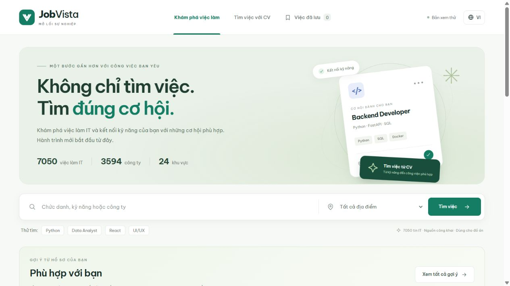

**Ảnh 01. Giao diện trang chủ hệ thống JobVista.** Trang chủ hiển thị 7.050 tin, 3.594 công ty và 24 khu vực chính. Thẻ Backend Developer trong banner là minh họa giao diện, không phải một kết quả xếp hạng.

Kịch bản trình diễn khoảng 7–10 phút:

| Bước | Thao tác | Điểm cần giải thích | Ảnh |
|---|---|---|---|
| 1 | Mở trang chủ | Catalog 7.050 tin, 3.594 công ty, 24 vùng | 01 |
| 2 | Gõ DevOps, chọn Hồ Chí Minh, tìm kiếm | Kết hợp từ khóa và bộ lọc, 72 tin trong lần chụp | 15 |
| 3 | Đặt lại, mở Fullstack Java Developer | Chi tiết bật/tắt, lương và kinh nghiệm thống nhất | 03–04 |
| 4 | Cuộn đến Cơ hội tương tự | Item-to-item dựa nội dung, ba gợi ý | 05 |
| 5 | Tìm việc với CV, tải CV07 PDF | Đọc tệp thật; Word/ảnh có nhánh xử lý tương ứng | 06 |
| 6 | Đọc và kiểm tra thông tin | Tám kỹ năng, Cần Thơ, ba năm; có thể chỉnh sửa | 07–08 |
| 7 | Bấm Tìm công việc phù hợp | Nhóm cân bằng đứng đầu, giải thích 70/30 | 09 |
| 8 | So sánh hai nhóm bên dưới | Chuyên môn tốt nhất có thể ở xa, việc gần nhà đạt ngưỡng | 10 |
| 9 | Xem danh sách chính, mở một tin | Bốn việc Cần Thơ, lý do khớp và điểm thành phần | 11–13 |
| 10 | Lưu một tin, về trang chủ | Việc đã lưu; hồ sơ được nhớ để cá nhân hóa | 14, 02, 16 |

Tệp demo kèm theo: `CV_demo/CV07_devops_can_tho.pdf`, sao chép nguyên bản từ bộ CV giả lập
của project. Có thể thử thêm ảnh và Word trong `data/sample_cvs` của repo.
Kết quả/số thập phân có thể đổi theo lịch sử trình duyệt, số mẫu rating, trạng thái semantic
và phiên bản catalog. Không khẳng định luôn phải giống hệt ảnh.

## 10. Demo các chức năng chính của hệ thống JobVista

Các ảnh dưới được chụp ngày 14/11/2026 ở viewport 1265 × 712, giữ nguyên JPEG của công cụ
chụp. Khi đưa vào Word, nên dùng khổ ngang hoặc chiều rộng trang cho các ảnh nhiều cột.
Ảnh 12 và 13 bổ sung nhau để đọc toàn bộ phần giải thích, không phải hai lần chấm khác nhau.

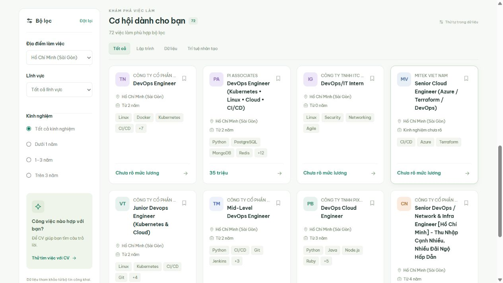

**Ảnh 15. Tìm kiếm DevOps kết hợp bộ lọc Hồ Chí Minh.** Gõ DevOps, chọn Hồ Chí Minh, bấm Tìm việc: 72 tin phù hợp bộ lọc trong catalog hiện tại. Đây là kết quả tìm kiếm từ khóa, không phải 72 khuyến nghị CV.

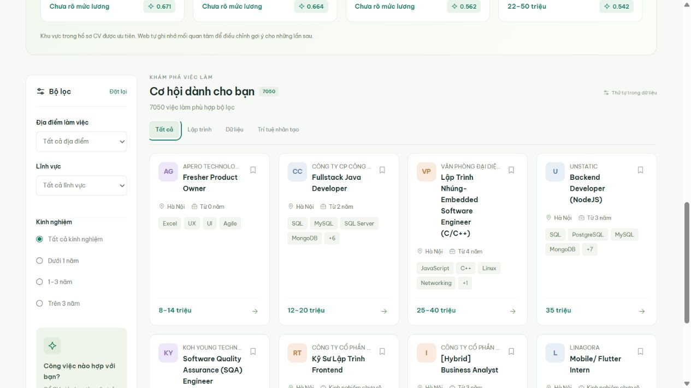

**Ảnh 03. Danh sách việc làm và bộ lọc.** Khi đóng chi tiết, màn hình rộng có bốn thẻ mỗi hàng. Bộ lọc gồm địa điểm, lĩnh vực và kinh nghiệm; phân trang tám tin mỗi trang.

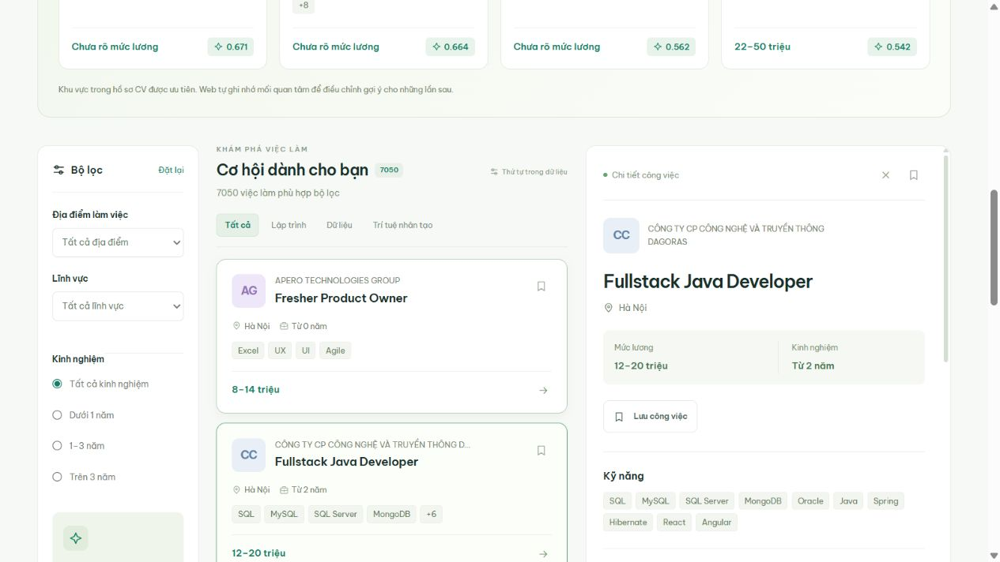

**Ảnh 04. Bảng chi tiết tin tuyển dụng.** Nhấp Fullstack Java Developer để mở chi tiết: lương 12–20 triệu và tối thiểu 2 năm. Nhấp lại cùng tin, nút X hoặc ESC để đóng.

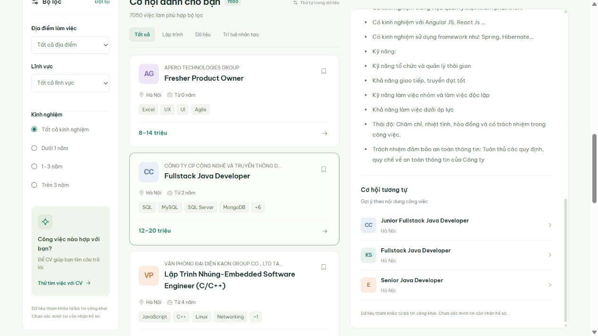

**Ảnh 05. Gợi ý công việc tương tự theo nội dung.** Cuộn trong bảng chi tiết đến Cơ hội tương tự. Hệ thống trả về các tin gần nội dung với tin đang xem, loại chính tin đó và nhóm gần trùng.

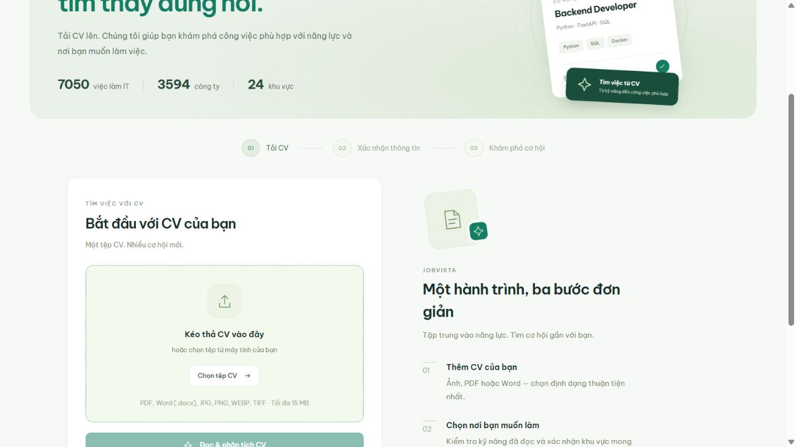

**Ảnh 06. Giao diện tải tệp CV.** Tại Tìm việc với CV, chọn PDF, Word .docx hoặc ảnh. Nút đọc chỉ bật sau khi chọn một tệp hợp lệ.

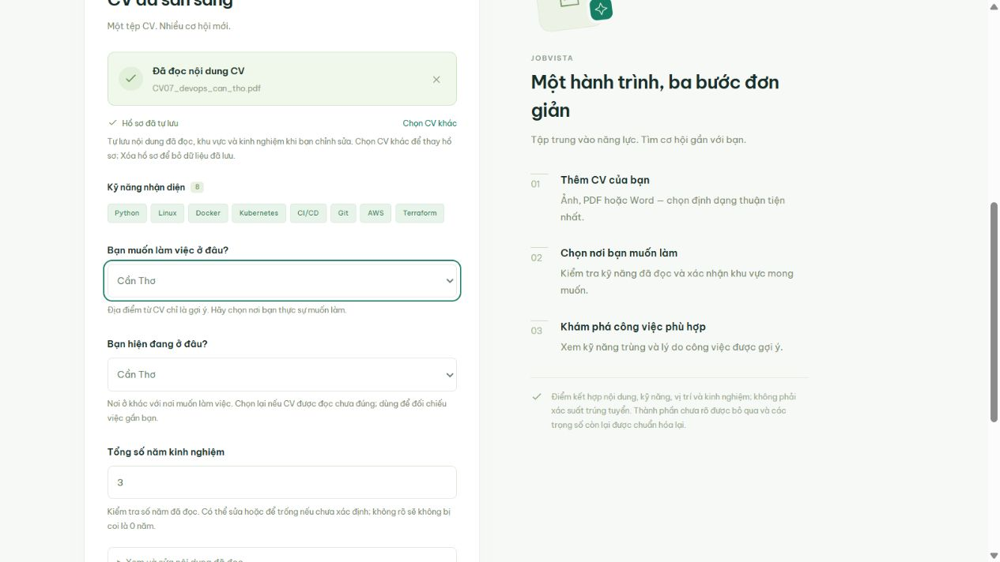

**Ảnh 07. Kết quả nhận diện kỹ năng, nơi ở và kinh nghiệm.** CV07 PDF được đọc thực tế: tám kỹ năng, nơi muốn làm Cần Thơ, nơi ở Cần Thơ, ba năm kinh nghiệm. Người dùng có thể xác nhận hoặc sửa.

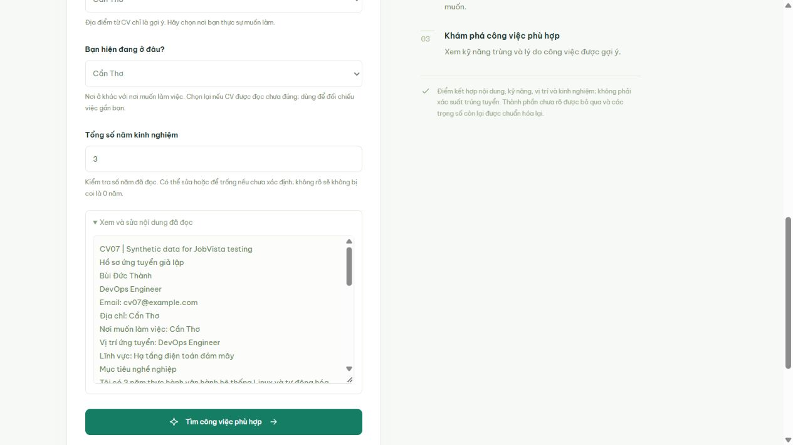

**Ảnh 08. Kiểm tra và chỉnh sửa văn bản CV đã đọc.** Mở Xem và sửa nội dung đã đọc để đối chiếu văn bản trước khi bấm tìm việc. Hồ sơ trong ảnh hoàn toàn là dữ liệu giả lập.

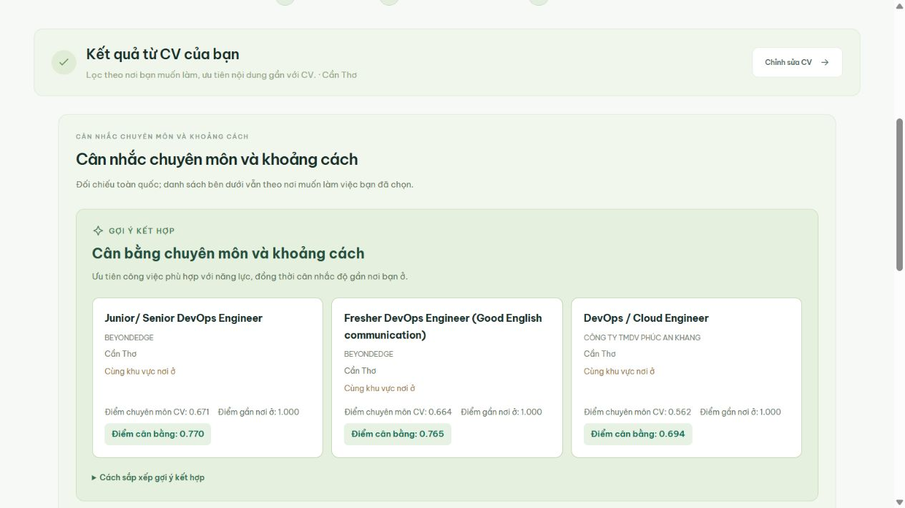

**Ảnh 09. Khuyến nghị kết hợp chuyên môn và khoảng cách.** Nhóm kết hợp được đưa lên đầu: chuyên môn CV 0,671, điểm gần 1,000, điểm cân bằng 0,770 ở tin đứng đầu trong lần demo này.

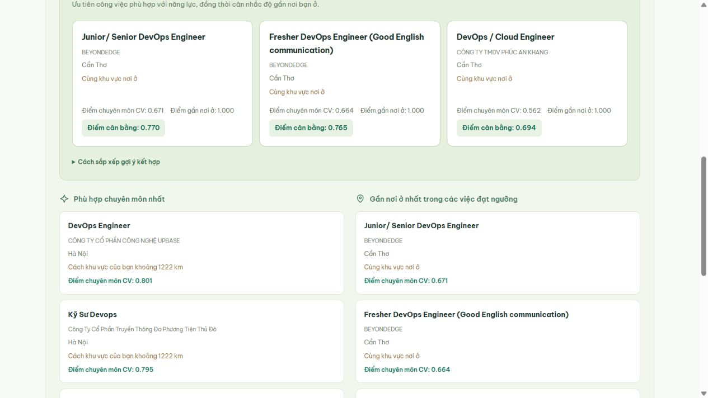

**Ảnh 10. Đối chiếu chuyên môn tốt nhất và việc gần nhà.** Tin đứng đầu theo chuyên môn ở Hà Nội đạt 0,801 nhưng cách vùng Cần Thơ khoảng 1.222 km; tin gần nơi ở đạt 0,671. Đây là đối chiếu toàn quốc, tách khỏi danh sách chính.

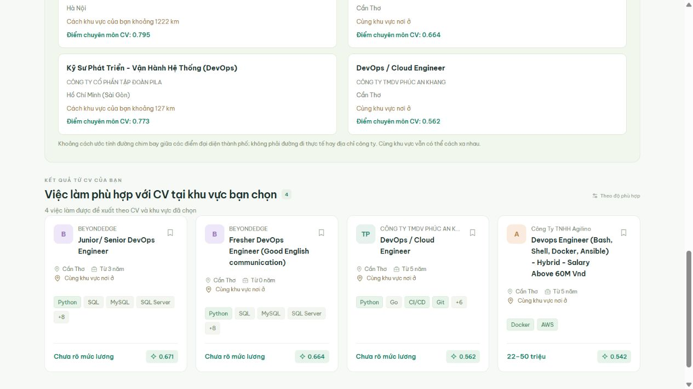

**Ảnh 11. Danh sách công việc phù hợp CV tại khu vực đã chọn.** CV07 với nơi muốn làm Cần Thơ trả bốn tin trong lần demo. Số lượng không bị ép đủ 24 nếu không có đủ tin qua điều kiện.

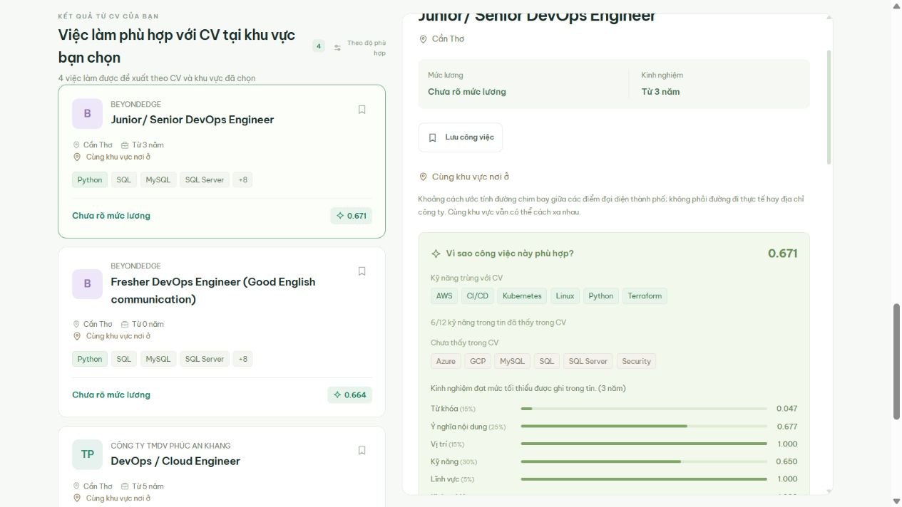

**Ảnh 12. Giải thích điểm chuyên môn và kỹ năng trùng.** Mở tin Junior/ Senior DevOps Engineer: sáu trong mười hai kỹ năng của tin đã thấy trong CV. Hệ thống hiển thị kỹ năng chưa thấy và từng thành phần điểm.

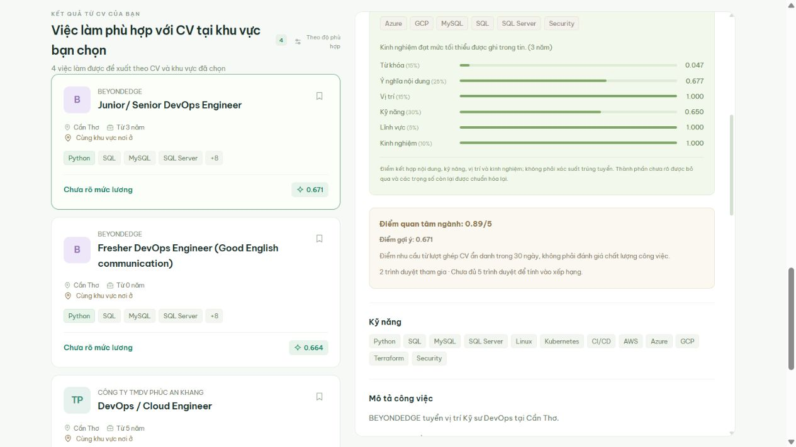

**Ảnh 13. Giải thích rating nhu cầu nghề nghiệp.** Ảnh tiếp nối phần giải thích điểm. Có hai trình duyệt tham gia trong dữ liệu demo, chưa đủ năm nên rating chưa tác động thứ hạng; không tạo lượt giả để làm đẹp ảnh.

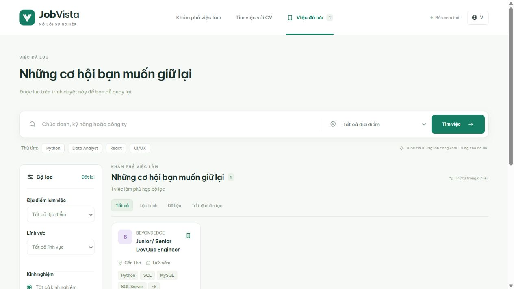

**Ảnh 14. Chức năng lưu công việc yêu thích.** Bấm biểu tượng lưu một tin rồi vào Việc đã lưu. Danh sách chỉ lưu trong trình duyệt; tin thử đã được bỏ lưu sau khi chụp để khôi phục trạng thái ban đầu.

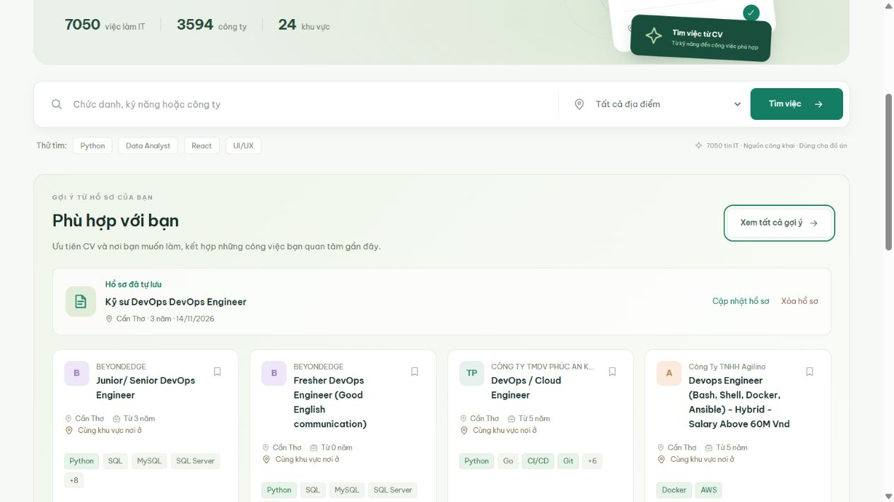

**Ảnh 02. Khối gợi ý cá nhân hóa trên trang chủ.** Hồ sơ CV07 được tự lưu trên trình duyệt; khu vực Cần Thơ và 3 năm kinh nghiệm được giữ lại cho các lần gợi ý sau.

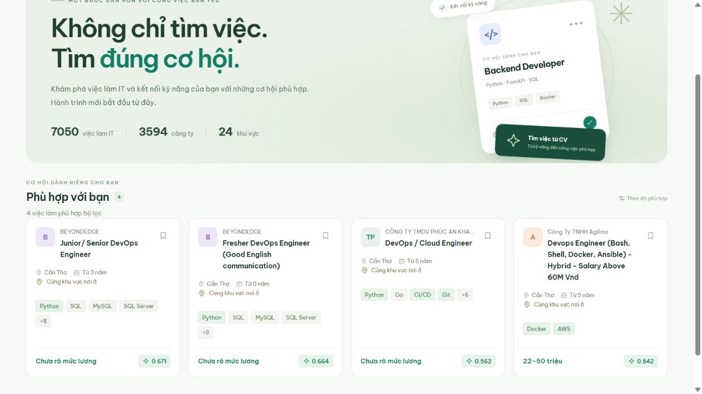

**Ảnh 16. Xem toàn bộ danh sách gợi ý cá nhân.** Từ khối Phù hợp với bạn, bấm Xem tất cả gợi ý. Hồ sơ Cần Thơ vẫn được ưu tiên; một lượt tìm ở Hồ Chí Minh không tự thay nơi muốn làm của CV.

Lưu ý khi viết kết luận: ảnh minh họa chức năng hoạt động, không đo độ chính xác mô hình.
Kết quả đánh giá A/B/C hiện có thuộc benchmark pilot 500 tin và CV tổng hợp, không áp dụng
trực tiếp cho toàn bộ catalog 7.050 tin hay chất lượng tuyển dụng thực tế. Các trọng số
và chính sách khoảng cách là cấu hình thử nghiệm, còn cần đánh giá thêm bằng người dùng thật.

Gói này chỉ bổ sung tài liệu/code trích/ảnh minh họa, không thay đổi thuật toán hoặc giao diện ứng dụng.
